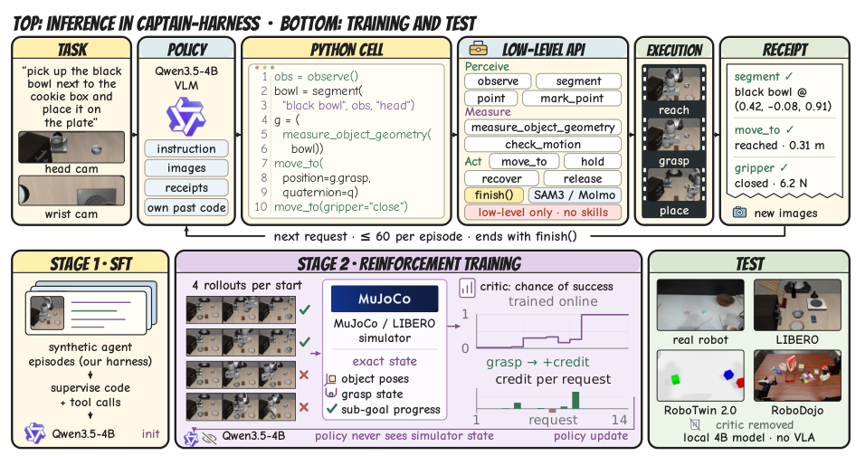

# CaPtain：交互数据、SFT＋RL与调用级信用分配

CaPtain: A Pipeline for Post-Training Code-as-Policy Robot Agents

团队：香港中文大学 MMLab、NovaXBot。Yijia Fan、Xilin He、Yilei Jiang、Dongming Wu、Jiaxu Wang、Xiangyu Yue。依据作者公开33页技术论文，2026。

[paper](https://waltstephen.github.io/captain/assets/paper/CaPtain.pdf) · [code](https://github.com/waltstephen/CaPtain) · [website](https://waltstephen.github.io/captain/)

## 问题与解决方案

小模型难以根据视觉反馈持续编写机器人控制代码；仅用最终成败，难以区分长轨迹中不同模型调用的贡献。CaPtain 先用交互示范 SFT，再用仿真物理状态 Critic 辅助 RL，训练 Qwen3.5-4B 的代码生成和工具使用。

## 系统框架与输入输出

| 模块 | 输入 | 输出／作用 |
|---|---|---|
| Qwen Actor | 任务与 API、头部／腕部图像、历史代码、执行 receipts | 推理、Python cell、工具调用 |
| Python 执行器 | 生成的代码 | 组合感知、几何、运动、夹爪接口 |
| 机器人后端 | 位姿、夹爪等参数 | 执行动作，返回状态、停止原因、接触力等反馈 |
| Critic，仅训练 | 隐藏仿真状态特征、request 序号、任务标识 | 预测当前状态最终成功的概率 |

提供22种低层能力加 `finish()`，不提供 VLA 或高层 `grasp/place` 技能。一次 request 是一次模型调用，可以生成包含多次原语操作的代码；Critic 的信用分配单位是 request，而非每个底层动作。

来源：论文 §3.1、图2、附录 A/B。

## SFT 数据从哪里来

教师在同一 Harness 中看图、写 Python、调用工具并接收反馈，采集成功交互。另加入学生自生成成功轨迹和视觉 QA。**图像是真实样本的一部分，网页上看到的文字只是对话序列的文本表示。**

| 数据类别 | 一条样本包含什么 | 学习目标 |
|---|---|---|
| 机器人交互 | 任务/API、当时图像、此前代码与反馈、当前模型输出 | 学习推理、代码和工具调用 |
| 视觉 QA | 图像、视觉问题及答案；可打包为一行 | 保持视觉与空间理解，loss weight 0.5 |

一条 episode 是完整任务尝试，包含连续 request；可以拆成多条带历史上下文的训练行，不能将行数当 episode 数。

**论文训练混合与公开数据集是不同口径：**

| 来源／数量 | 论文表5 | 公开数据卡 |
|---|---:|---:|
| 机器人交互训练行 | 17,442 | 15,921 |
| 视觉 QA 行 | 8,519 | 8,519 |
| 总训练行 | 25,961 | 24,440 |
| 总 token，含图像计量 | 861M | 797.1M |
| 完整交互 episode | 表5未给全体数量 | 2,036 |

17,442由论文总行数减QA行数计算。公开集的2,036条包括267条学生成功 episode，不能全部称为 Astra 示范。公开交互来自 LIBERO；基础覆盖含 libero_90／10／goal／object／spatial，困难采集集中于 libero_10、libero_goal。不得把公开集2,036条与论文861M拼成同一规模。

SFT 更新语言模型参数、冻结视觉塔：视觉编码器不参与梯度更新，语言模型仍通过图像特征学习生成决策代码。

来源：论文附录 C、表5；已保存的官方 `dataset-card.md`；官方代码 `sft/`。

## RL：多少数据更新一次

任务来自 LIBERO spatial、object、goal、long 共40任务。初始池7,360个状态，649个退化目标区域状态不抽取；评测的240个官方初始状态不参与采样。

| 阶段 | 数据量与处理 | 参数更新 |
|---|---|---|
| Critic 预热 | 较早策略1,000条 episode，约45k个request状态 | 初始化5个MLP组成的Critic |
| 第1轮 rollout | 64个初始状态，每个尝试4次＝256 episodes | 先用更新前Critic计算优势 |
| 第1轮 Critic训练 | 使用这256条轨迹的全部request状态 | 2次AdamW更新 |
| 第2、3、4轮 | 每轮重新采集256条，重复优势计算与Critic更新 | Qwen梯度累积 |
| 累计4轮 | 1,024条 episode | Qwen做1次优化器更新，权重同步采样端 |
| 主结果检查点 | 第300轮，共76,800条 episode | Qwen共75次更新；Critic循环内600次更新 |

**不是每128条更新一次Critic。** 原文是每轮256条轨迹的全部request状态，做两次更新。600次由300×2计算，不含Critic预热。

Qwen每条episode最多均匀抽8个request参与策略梯度训练，并作抽样权重补偿；Critic仍用全部request。采样与训练异步，允许最多落后2个策略版本。原文另有每十条一次、不参与梯度的监测流，不将监测记录理解为训练样本。

来源：论文附录 A，Policy update／Training distribution；`rl/README.md`、`rl/critic_cotrain.py`。

## Critic 怎样评分、怎样影响 Qwen

用户关注：“Critic事先预测，执行后再预测，对这个调用评分吗？”

**基本如此，但它预测的是任务最终成功概率，并通过优势影响训练；不会直接替 Qwen 输出更好的代码。**

| 信号 | 做法 | 影响 |
|---|---|---|
| 调用前后价值差 | 对执行前、后物理状态打分，使用相同request时间索引 | 估计这次调用是否推进任务 |
| 即时执行成本 | 惩罚失败／拒绝动作、超额动作和成功后继续执行 | 抑制无效操作 |
| 后续结果 | GAE，λ=0.9、无折扣 | 将后续推进分配给此前调用 |
| 真实终局结果 | 成功并finish为1；成功未finish为0.25；错误finish为−0.3；预算耗尽−0.1；其他失败0 | 任务完成与终止判断的真实监督 |
| 同组相对表现 | 同一初始状态4次尝试比较“终局回报＋成本” | 区分整条尝试优劣 |

最终优势组合组间结果项和episode内中心化的GAE项，再用运行中的标准差缩放；同一request生成token共享该优势。不是五个独立加权评分器。

Critic由5个三层、每层256单元的MLP组成，输入36维物理状态特征、request序号和任务one-hot；用该episode的最终host success训练。8个困难任务另有受限的阶段奖励。Critic也用于早停明显无望的rollout，存在控制子集与困难任务例外。

执行成本中，超过SFT任务动作数中位数1.5倍的物理动作每次−0.008；失败／拒绝动作每次−0.02；成功后动作与请求的总成本上限为−0.45。仅感知请求的即时物理价值差可接近零，仍能通过后续GAE和组内结果获得信用。

**部署不需要Critic。** 其特权状态监督不能直接照搬到只有粗粒度文本日志的真机系统。

来源：论文 §3.3、附录 A，式9–10；`rl/physics_critic.py`。

## 结果与适用边界

| 配置 | 留出LIBERO成功率 | LIBERO-PRO成功率 |
|---|---:|---:|
| 基础Qwen3.5-4B | 0.0% | 0.3% |
| SFT | 55.4% | 59.5% |
| SFT＋RL | 73.8% | 78.5% |

留出LIBERO为40任务×6初始状态＝240 episodes。跨本体RoboTwin2.0为22.6%，RoboDojo为0.8%，迁移仍有明显限制；不能据此认为低层代码已全面替代VLA。真机XR1在模拟XR1上适配后部署，未使用真机训练数据；论文图5为两条真机执行展示，不能当总体成功率。

训练资源：SFT约120 H100-hours；RL约1,290 H100-hours，通常8卡训练＋8卡采样／感知节点。以上是论文运行配置，不是最小显存需求。

## 对 Harness 的收获

PyRUA-Lean Coder直接GRPO、按完整episode回报训练，与现有移动／抓取／VLA原语调度更接近。CaPtain值得参考的是明确的执行receipts和request级信用分配；引入物理Critic前，需要确认能否提供稳定的状态特征。

这属于迁移判断。两篇的任务、接口与预算不同，不能用绝对成功率直接排名，也不能把CaPtain的全部RL收益归因于Critic。

整理：Codex，2026-10-31；依据原文、官方数据卡、已有源码核查及用户提问，未运行训练。
