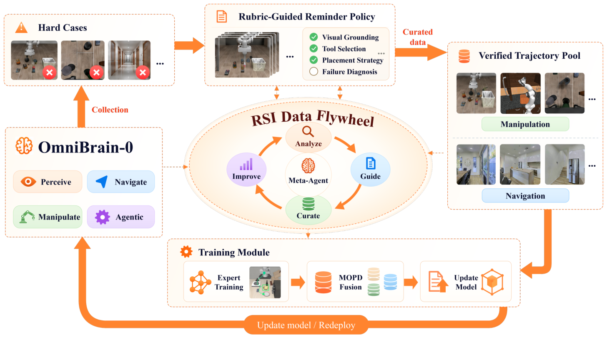

# OmniBrain-0：模型产生、交互采集与RSI迭代

OmniBrain-0: A Unified Agentic Model for Embodied Intelligence

团队：小米具身智能团队、澳门大学、清华大学。arXiv:2610.36013v1，2026-10-26，技术报告。

[paper](https://arxiv.org/abs/2610.36013v1) · [code](https://github.com/luo-yc17/OmniBrain-0) · [website](https://public-bots.github.io/OmniBrain-0/)

官方仓库目前提供项目展示材料，训练代码标记 release soon。以下依据论文，未作训练源码验证。

## 问题与核心思想

小模型难以复现强模型的长期规划、进度判断和失败恢复。作者从强模型交互轨迹训练操作与导航专家，再将两类能力蒸馏进同一个上层决策模型；通过执行提醒与新增轨迹继续改进。

统一的是**上层VLM Planner**。它输出决策和工具调用，下层VLA、导航策略、感知和运动工具负责执行。

## 先后顺序：Base不是最后的统一模型

用户关注：“经过具身预训练、领域提炼、MOPD得到base，然后得到交互数据？”

需要分清：初始教师数据在训练前准备；第一阶段结束得到OmniBrain-Base，第三阶段结束才得到OmniBrain-0。后续RSI由OmniBrain-0采集新经验。

```text
强模型采集初始交互示范 ＋ 准备具身QA
                     ↓
Qwen3.5 → 具身预训练 → OmniBrain-Base
                     ↓
       操作轨迹SFT ／ 导航轨迹SFT
                ↓          ↓
             操作专家    导航专家
                 ＼       ／
          MOPD训练Base初始化的学生
                     ↓
                OmniBrain-0
                     ↓
      新交互 → 提醒改进 → 验证成功轨迹
                     ↓
      继续训练领域专家 → MOPD → 再执行
```

来源：论文 §4–5、图5和图7。

## 初始数据怎么采集

GPT-5.6-Sol、GLM-5.3-Flash担任上层Agent，在LIBERO/LIBERO-Pro、RoboTwin2.0、RoboCasa365、R2R-CE中看图、调用工具、读取反馈，逐步执行至任务结束。

初始有效示范3,846条；RSI另新增1,142条，共4,988条。总池来源为LIBERO/LIBERO-Pro 2,349条、RoboTwin2.0 513条、RoboCasa365 880条、R2R-CE 1,246条。**这些是筛选后示范数，不是全部试错次数。**

每条轨迹记录任务、图像、机器人状态、决策文字、工具调用、环境反馈。通过规则与视觉检查后，保留正常成功及恢复成功，过滤最终失败、盲目重复、缺失证据和不一致记录。最终失败仍可用于问题诊断。

来源：论文 §4.1、附录C、图C.1。

## 三阶段训练：谁监督谁

| 阶段 | 数据与操作 | 产物／更新对象 |
|---|---|---|
| 具身预训练 | 具身QA与长程交互数据训练Qwen3.5-9B，另有4B版本 | OmniBrain-Base |
| 领域专家SFT | 从Base分别初始化，以操作／导航示范监督决策文字和工具调用 | 操作专家、导航专家；均是上层决策模型 |
| MOPD | 学生从Base初始化，自行生成决策前缀；对应领域专家给token概率分布，用Reverse KL对齐 | 冻结专家，仅更新统一学生，得到OmniBrain-0 |

**采集示范的GPT／GLM，与MOPD中的两个领域教师不是同一层模型。** MOPD是on-policy蒸馏，不是依赖终局奖励的GRPO。

| 配置 | 预训练 | 专家SFT | MOPD |
|---|---:|---:|---:|
| epoch | 2 | 3 | 2 |
| 论文batch size | 1 | 2 | 2 |
| 梯度累积 | 4 | 2 | 2 |

使用16张H20、BF16，冻结教师部署在专用GPU。batch未明确为每卡还是全局，不能据此计算总optimizer更新次数；视觉塔冻结范围未详述。图C.1标注VQA为820,453条，正文又称混入交互数据后约820K，混合口径并未完全说明。

来源：论文 §4.2–4.4、附录C。

## 模型如何执行任务

每次读取任务、当前图像、本体状态、交互历史和工具反馈，选择一个工具及参数；**工具执行返回后才进行下一次高层决策**。

操作技能包括π0.5、LingBot-VLA、RLDX-1，导航采用SmartWay；还可调用感知、末端运动和夹爪控制。出错后根据反馈重新定位、调整姿态或切换工具，而不是直接重复完整计划。

决策文字统一整理成四个字段，训练时只能使用当时可获得的信息：

| 字段 | 记录内容 |
|---|---|
| `Phase` | 定位、抓取、运输、放置、验证、恢复阶段 |
| `State` | 持有物体、夹爪状态、目标位置、当前子目标与进度 |
| `Evidence` | 支持判断的图像和工具反馈 |
| `Decision` | 下一次工具调用和相应操作 |

来源：论文 §3、§4.1。

## 经验组织：三类用途

| 形式 | 如何形成 | 怎么使用 |
|---|---|---|
| Experience Library | 强模型跨episode探索、反思，人工审核整合 | 给后续执行提供经验先验 |
| Rubrics／Reminders | Meta-Agent分析成功、失败和低效证据，更新执行准则并验证提醒 | 在相关状态、下一次调用前插入指导 |
| 训练轨迹池 | 正常成功和失败后恢复成功，按时间对齐、清洗与检查 | 更新领域专家，再蒸馏统一模型 |

Experience Library分四类：General Principles、Task Execution Patterns、Failure Cases and Recovery Strategies、VLA/VLN Capability Boundaries。分别记录通用规则、任务阶段与技能组合、失败症状与恢复方法、何时使用学习技能或显式控制。

**主表OmniBrain-0与RSI结果评测时不使用外部Experience Library。** 不能把few-shot检索经验与模型训练收益混成一个实验。

来源：论文附录A、§5、§6.2。

## RSI：先改提醒，再训练模型



| 顺序 | 操作 | 参数是否更新 |
|---|---|---|
| 1 | OmniBrain-0执行并收集难例 | 否 |
| 2 | GPT-6.1-Sol Meta-Agent分析轨迹，新增／修订rubrics | 更新外部指导 |
| 3 | 当前上下文出现相关问题时，在下一次工具调用前插入提醒 | 否 |
| 4 | 固定模型试运行；GPT-5.6-Sol评价任务完成和效率，保留有效提醒 | 否 |
| 5 | 从新交互中整理成功轨迹，加入操作／导航训练池 | 更新数据 |
| 6 | 继续SFT领域专家，再MOPD统一学生，重新部署采集 | 是 |

论文酒瓶放入碗的例子在抓取前和后续移动前触发提醒，其余步骤不提醒。不是每一步由Meta-Agent重规划，也不是机器人每做一个动作就更新权重。

原文未给出固定的每任务开发次数、总RSI轮数、每轮采样量、多少episode触发一次训练；1,142条新增示范不能据此换算轮数。

## Sim2Real与结果

原文§6.4.1明确将高层Planner迁移到真机，**不针对真机评测任务额外微调**。真机感知、运动与VLA接口执行后返回反馈，Planner继续决策。夹爪、相机、控制器对齐细节和逐任务真机开发预算没有完整报告；不能扩大为整个底层系统从未使用真机数据。

| 真机，每任务20次 | π0.5 | OmniBrain-0 | GPT-5.6-Sol |
|---|---:|---:|---:|
| 堆积木 | 50% | 75% | 90% |
| 苹果入碗 | 40% | 60% | 75% |
| 开抽屉 | 85% | 85% | 95% |
| 平均 | 58.3% | 73.3% | 86.7% |

| 仿真／导航基准 | 9B | RSI |
|---|---:|---:|
| LIBERO-Pro | 65.5% | 69.3% |
| LIBERO-Plus | 83.8% | 84.5% |
| RoboCasa365 | 39.6% | 43.2% |
| RoboTwin2.0 | 88.2% | 89.4% |
| R2R-CE | 65.0% | 66.0% |

真机仅3种任务；RSI为完整方案的结果，没有单独量化每次提醒更新、新增数据和再训练各自的贡献。来源：论文表1–5、图8、附录B。

## 对 Harness 的收获

重点可以放在原语调用链的数据组织：除了调用参数与反馈，还记录当前阶段、状态、证据和下一决策，并保留恢复成功的过程。外部提醒先经交互检验，再让验证有效的轨迹参与Planner训练。

这是结合讨论提出的迁移方向，不能将论文结果视作我们系统已经验证的收益。

整理：Codex，2026-10-31；依据原论文与用户问题，未运行训练及真机实验。
