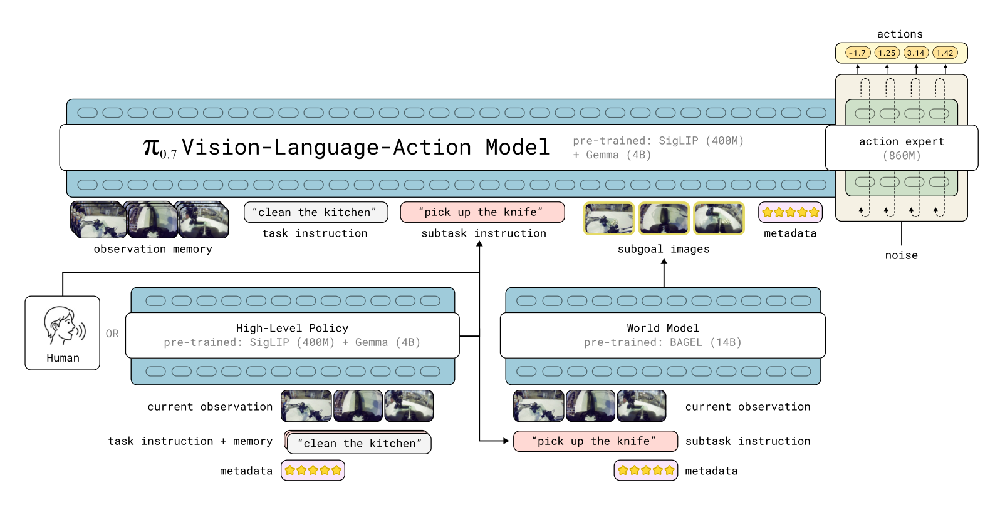

# π0.7：语言指导、目标图像与 VLA 训练

**论文：**π0.7: a Steerable Generalist Robotic Foundation Model with Emergent Capabilities<br>
**分类：**感知与执行／VLA训练与条件控制 · **团队：**Physical Intelligence · **发布：**2026-04-16<br>
[paper](https://www.pi.website/download/pi07.pdf) · [website](https://www.pi.website/blog/pi07) · π0.7 专用公开实现未找到；openpi 仅作 π0.5 接口对照。

[阅读版HTML](../reports/pi07.html)

## 本次阅读收获

利用 coaching 记录微调上层策略，生成子任务语言；单独训练 World Model，生成子任务的目标图像；下层 VLA 用真实轨迹学习依据这些条件生成动作。同一段动作分别提供离散 token 与连续动作监督，更新 VLM 主干和 Action Expert。Action Expert 读取主干特征，但其损失不反传到主干；主干仍由自己的交叉熵损失更新。

依据用户讨论整理，原文依据见各节。训练分工不代表论文规定的完整时间顺序。

## 三个模块怎样训练

| 模块 | 输入 → 学习目标 | 训练关系 |
|---|---|---|
| 上层 Planner | 当前观察、总任务、过去子任务指令 → 下一条子任务语言 | 在 coaching 实验中，将 π0.7 微调用作上层语言策略；不在此处直接预测连续动作 |
| World Model | 当前多视角画面、子任务、元数据 → 片段末尾的多视角图像 | 从 BAGEL 14B 初始化，以 flow matching 训练目标图像生成 |
| 下层 VLA | 观察与历史、机器人状态、文字、可选目标图像、元数据及控制模式 → 动作 | VLM 主干使用 FAST 动作 token 监督；Action Expert 使用连续动作监督，隔离后者到主干的梯度 |

**World Model 的数据：**高质量语言分段标注的机器人数据、第一人称人类视频，混入开源图像编辑与视频数据以保留语义知识。机器人训练样本包含当前3路相机图像及片段结束时的3路目标图像。

**上层的 coaching 数据：**先由人逐步指导已经具备语言执行能力的下层，记录当时观察、总任务、历史指令与人给出的新指令，再训练上层预测新指令。这一阶段不需要新增人工遥操作示范。论文图16在5个任务比较自主执行与人工 coaching，报告前者的任务进度接近后者。

来源：[原论文](https://www.pi.website/download/pi07.pdf) §V-A/B、§VI、图16、附录C。上层与下层同源架构、分别承担语言与动作输出；逐层冻结、参数共享实现与完整训练时间表未详细披露。

## VLA 的数据从哪里来

以下是一条**有动作标注的机器人轨迹样本**的组织方式；人类视频和网页图文不一定有机器人动作标签。

| 样本内容 | 来源与用途 |
|---|---|
| 当前／历史画面、机器人状态 | 轨迹中记录的观测，作为条件输入 |
| 总任务与子任务语言 | 数据标注；训练时不要求先运行上层 Planner |
| 子目标图像 | 真实轨迹的未来帧，或 World Model 生成的图像，作为条件输入 |
| 后续动作块 | 轨迹中实际记录的动作，作为监督标签；不是 World Model 生成的动作 |
| 质量、速度、错误、控制模式 | 标注／记录的上下文，用于区分数据中的执行方式 |

一条样本的关系是：**“当前观察＋子任务＋目标图像 → 真实动作块”。**目标图像是输入，动作才是预测目标。论文图3的微波炉例子中，第一步子任务是“按微波炉开门按钮”；图中展示输入组合，未给出动作数值。

真实目标图像的采样：25%取子任务片段末帧，75%从当前时刻后0–4秒采样；另加入生成的目标图像。这里的25%／75%是**真实目标帧的选择比例**；论文还另规定，每批25%的样本带目标图像，两者分母不同。

来源：[原论文](https://www.pi.website/download/pi07.pdf) §V-E、§VI-B/C、图3。

## 一段动作如何训练两个模块

下图为训练关系示意；不是先让主干生成一串动作，再交给 Expert 执行。

```text
观察／历史＋状态＋文字＋目标图像
                  ↓
              VLM 主干
              ├─ 预测 FAST 动作 token
              │          ↓
              │   与真实动作编码的 token 比较
              │          ↓
              │   交叉熵损失 → 更新主干
              │
              └─ 主干特征 → stop-gradient → Action Expert
                                              ↑
                         真实动作块＋噪声＋流时间
                                              ↓
                                      预测去噪变化方向
                                              ↓
                               Flow matching 损失 → 更新 Expert
```

- **同一段动作，两种监督：**离散 token 用来训练主干，连续动作用来训练 Expert。二者是 VLA 内相互连接的模块。
- **两部分都训练：**KI 的单阶段方案同时更新主干和 Expert，并非先训练完主干、再冻结主干训练 Expert。
- **只阻断一条梯度路径：**Expert 可以读取主干特征，Expert 的损失不能更新主干；主干仍通过自己的损失改变表示。
- **目的：**减少新接入的连续动作模块对预训练 VLM 表示与语言能力的干扰。它不保证主干特征完全不变，也不等于完全消除遗忘。

来源：[π0.7 §III](https://www.pi.website/download/pi07.pdf)；[Knowledge Insulation 官方说明](https://www.pi.website/research/knowledge_insulation)。π0.7 明确采用 KI；单阶段同时训练的具体解释来自该方法的官方说明，未据此补造 π0.7 的优化器和批次调度。

## 部署时怎样协作



| 部分 | 部署时的输入与输出 |
|---|---|
| 上层 Planner | 观察当前情况、总任务与历史，输出当前子任务语言 |
| World Model | 根据当前观察、子任务和元数据，生成期望的子目标图像 |
| 下层 VLA | 读取当前观察与历史、机器人状态、任务／子任务、最新目标图像及其他条件，输出动作片段 |
| 机器人反馈 | 执行动作后产生新的观测与状态，供后续决策使用 |

**异步更新：**子任务与目标图像分别生成，VLA 使用最新可用的版本。子任务改变或距上次生成达到4秒时刷新目标图像，取先发生者。VLA 一次生成50步，实验执行15或25步后再推理，通过 RTC 衔接动作。

**部署时不更新参数：**包含下层 VLM 与 Action Expert；新指令和新图像改变输入与输出，不改变权重。World Model 生成目标期间，下层继续执行。附录D报告目标图像生成使用4张 H100、25步去噪、耗时1.25秒，这是异步重叠计算的具体背景。

来源：[原论文](https://www.pi.website/download/pi07.pdf) 图2、§VII、算法1、附录D。图为作者原图。

## 需要区分的几个问题

| 关注点 | 核对后的表述 |
|---|---|
| 三个模块一起端到端训练吗？ | 论文分别描述其训练目标，没有报告上层→World Model→VLA 的全系统损失反传；生成图像进入 VLA 数据，不等于动作损失更新 World Model |
| 上层和下层完全同一个模型吗？ | 同源架构，上层另行微调用作语言策略；不能把架构相同写成共享同一套权重，具体共享实现未详细披露 |
| Action Expert 的梯度不影响主干，主干就不变吗？ | Expert 的损失不更新主干，但主干由自身损失更新；参数与特征仍会变化 |
| 现成 π0.5 可以直接接目标图像吗？ | 官方标准接口没有目标图像条件；新增图片字段不等于策略已学会使用，需要对应输入设计与动作条件训练 |

π0.5 的接口结论依据 [openpi 模型实现](https://github.com/Physical-Intelligence/openpi/blob/main/src/openpi/models/pi0.py)和 [DROID 输入适配器](https://github.com/Physical-Intelligence/openpi/blob/main/src/openpi/policies/droid_policy.py)，2026-10-29 读取；它们不是 π0.7 的公开实现。

## 我们的笔记

**用户理解，2026-10-29：**

> 利用coaching数据来训练上层planner输出相应的子任务语言，微调worldmodel来生成子任务的目标图像，在微调vla时，一条数据分别对vlm与action expert起作用，vlm与action expert的梯度断断开，感觉是不要让action expert的梯度变化影响本来vlm的特征表示

> 然后部署的时候，上层负责提供子任务，world model输出子任务图片，然后vla根据指导生成相应的动作

**核对：整体理解正确。**“梯度断开”准确说是阻断 Expert 损失到主干的反传，特征读取仍连通；“保持表示”是减少干扰，不是冻结主干；“子任务图片”应写为期望的子目标图像。三个模块的训练分工也不能据此排成论文未披露的固定先后顺序。

## 来源

- [π0.7 原论文](https://www.pi.website/download/pi07.pdf)：2026-04-16，§III、§V-A/B/E、§VI-B/C、§VII，图2/3/16，附录C/D。
- [π0.7 官方介绍](https://www.pi.website/blog/pi07)：language coaching、训练上层策略、子目标条件。
- [Knowledge Insulation](https://www.pi.website/research/knowledge_insulation)：2025-05-28，单阶段同时训练与梯度隔离。
- [openpi](https://github.com/Physical-Intelligence/openpi)：仅用来核对现成 π0.5 的输入接口；未作为 π0.7 代码来源。

整理：Codex，根据用户讨论与上述原始资料核对；2026-10-29。
