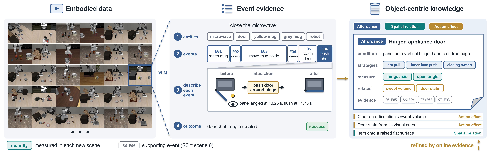
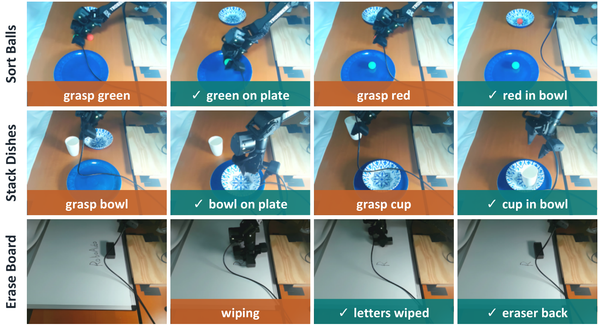

# RoboAuto：初始化与 Sim2Real

**完整标题：**RoboAuto: Autonomous Robot Program Search through Multi-Level Physical Understanding<br>
**团队：**Washington University in St. Louis（圣路易斯华盛顿大学）<br>
**作者：**Buzhao Liu、Jianing Ye、Xiu Yuan（共同一作）；共9位作者。<br>
**版本：**arXiv:2610.36533v1 · 2026-10-27<br>
[paper](https://arxiv.org/abs/2610.36533v1) · [website](https://roboauto-ai.github.io/) · 官方项目页未提供代码链接（2026-10-29）。

[阅读版HTML](../reports/roboauto.html)

## 问题与核心方法

仅凭执行反馈修改代码，可能一直优化错误的物理假设，例如抓取位置不合适、没有测量当前物体几何，或者没有确认前置步骤真的完成。

RoboAuto用分层知识库提供物体交互知识，针对当前场景重新测量，再分阶段生成和验证程序；原因不清楚时，单独设计实验检查物理假设。改进对象是知识、技能和任务程序，论文没有报告训练LLM／VLA参数的流程。

**本文的Sim2Real是：把仿真中获得的物体知识与技能库带到真机，在真机场景重新测量和搜索程序，再在独立初始位置上评测。**真机任务有自己的程序搜索预算。

## 怎样初始化

### 先准备模型、工具与知识

| 对象 | 初始来源与作用 |
|---|---|
| Coding Agent | 仿真使用Claude Opus 4.6，1M上下文；根据指令、知识和反馈写／修改程序 |
| 感知与控制接口 | 扩展CaP-Bench，提供深度观察、Molmo2指点、SAM 3分割、Contact-GraspNet抓取候选及机器人控制原语 |
| 初始物体知识 | LIBERO-90每个源任务取1段成功示范视频，即90段；VLM从视频提取事件证据，再跨记录归纳知识 |
| 可执行技能层 | 保存程序搜索中经过验证的程序组件；论文没有说直接把这90段视频转换为可执行代码 |

初始知识构建流程见原论文图12：



VLM先识别实体，将视频划分为交互事件，记录“之前状态—交互—之后状态—视觉证据”，再判断该episode结果。跨事件提炼出三类知识：

- **Affordance：**某类物体适合怎样接触、抓取或操作。
- **Spatial relation：**支撑、包含、相对位置等关系。
- **Action effect／precondition：**动作应改变什么状态，需要满足什么条件。

条目还保存适用条件、候选策略、证据和`open_quantities`，后者列出必须在新场景测量的量，例如杯口半径、把手方位、铰链轴。物体知识层不保存特定场景的数值、关节轨迹或API调用；可执行技能是另一层，二者不能混同。

来源：§3.1、附录A.3、B.1、C.1；`paper.tex` L91–99、323–337、364–442、1071–1116。论文用“VLM”描述知识构建器，相关段落没有给出该构建器的具体型号。

### 新任务不是先写动作，而是先测量

Coder的首轮流程在附录E.1明确列出：

1. 查看初始画面，检索相关知识及需要测量的量。
2. 写测量探针，通过视觉、分割和深度观察获取当前场景参数。
3. 将结果写入`measurements.json`，记录已知量与未解决条件。
4. 建立`diagnosis.md`，再写`plan.md`和每个阶段的代码／验证器。

每阶段检查的是**物体是否达到预期状态**，例如杯子被稳定拿起、物体已放到指定容器，而不是仅凭机械臂到达某个位置就算完成。失败时优先修正最早未完成的阶段；独立审计会话可根据视频推翻程序验证器的判断。原因不清楚时，另写诊断实验，不必反复运行整个长任务。

来源：§3.2–3.3、附录C.2–C.3、E.1；图2、图13。

## Sim2Real怎样进行

```text
LIBERO-90示范 → 初始化物体知识
LIBERO任务搜索 → 知识修正＋经过验证的代码技能
                         ↓ 迁移分层知识库
真机当前画面／深度 → 检索与重新测量
                         ↓
Opus 5在真机接口上生成、执行和修正任务程序
                         ↓ 最多10次搜索rollout
独立初始位置：每任务20次评测
```

**迁移的内容：**在LIBERO获得的分层知识库，包括物体知识与可执行技能。真机三个任务均不同于知识库构建任务。新场景的几何参数要重新建立，动作通过当前机器人接口实现，不能把知识迁移解释为原仿真关节轨迹直接回放。

**真机平台：**WidowX AI机械臂，Intel RealSense D405 RGB-D相机与Logitech C920 RGB相机。对比方法采用相同硬件、传感器配置与控制接口。

**目标域搜索：**RoboAuto与ASPIRE均使用Opus 5、1M上下文，每个任务最多10次搜索rollout。搜索中由人判断成败，替代仿真环境的成功判定；每次rollout后由人重置场景，并维护机械臂和周围环境安全。

**独立评测：**每任务20次，物体初始位置从相同区域独立采样，与搜索时的位置不同。每次由人评估阶段完成比例。因此，结果体现的是“迁移知识后，在目标任务上搜索程序，再泛化到新位置”，不属于未经目标任务搜索的直接部署。

来源：§4.4、Limitations、附录F；`paper.tex` L208–239、1521–1542。文中没有给出相机外参标定、机器人接口适配及技能逐项改写的完整实现细节，不能补写成已自动完成。

## 结果与迁移边界



以下为**平均阶段完成评分**，每任务20次，不能统称整任务成功率。

| 真机任务 | RoboAuto | ASPIRE | π0.5 |
|---|---:|---:|---:|
| Sort Balls：分别将两球放到指定位置 | 100.00% | 30.00% | 0.00% |
| Stack Dishes：碗放盘上、杯子竖放碗中 | 100.00% | 3.75% | 0.00% |
| Erase Board：拿橡皮、擦字、放回 | 95.83% | 0.00% | 0.00% |

Sort Balls和Stack Dishes各4阶段，每阶段占1/4。Erase Board各大阶段占1/3，擦字部分按8个字母擦除数量继续给部分分。π0.5采用DROID微调checkpoint；正文未详述其跨本体适配。来源：表1、附录F。

**另一个受控迁移实验：**从LIBERO迁移到RoboTwin 2.0，改变仿真器、本体和控制原语；两组都允许程序搜索及实验，预算均为11次rollout。4任务平均成功率从无保留知识的24.5%提高到有分层知识库的91.5%。这是跨仿真器／本体迁移，不能作为真机成功率使用。来源：附录A.1.5、B.4、表14。

**初始化与评测的界限：**每个独立评测任务会恢复到该实验规定的初始知识条件；仿真测试场景结果不会用于修改知识库。论文不能被解读为所有测试任务顺序执行、不断吃前一测试任务的经验。来源：附录A.2–A.3。

## 本次问题与阅读收获

用户关注：怎样初始化，以及怎样Sim2Real。

- 初始化主要包括预训练模型与工具接口，以及从90段示范视频提炼的物体知识；并非从零训练控制策略。
- 通用知识保留“怎么操作、需要测什么、如何确认效果”，当前场景负责提供具体数值，程序负责实现动作。
- 真机包含10次目标任务程序搜索及人工重置／成败判断；20次评测才使用独立的新位置。
- 可迁移物体知识、机器人接口相关技能与具体场景参数是不同层次，不能混称同一套动作策略直接迁移。

整理：Codex依据原论文v1及官方项目页，2026-10-29；未运行机器人代码。论文源文件、39页PDF与原图均已保存。
