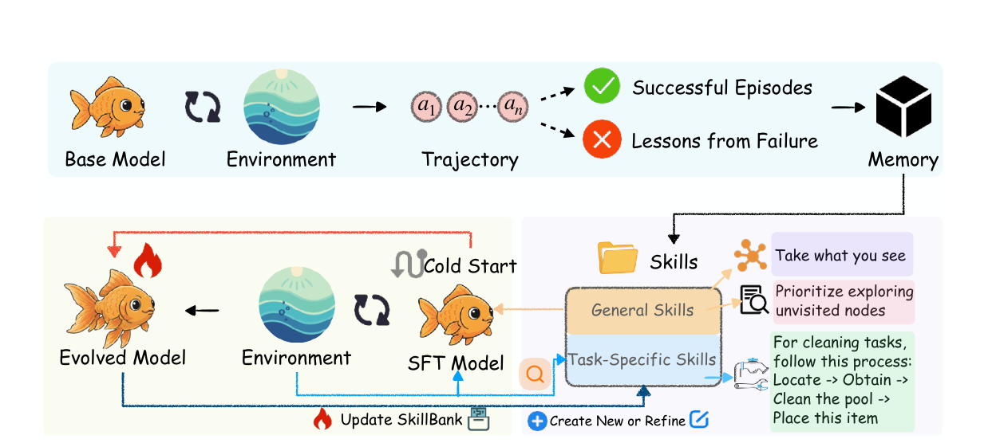

# SkillRL：技能库与策略参数如何共同更新

SkillRL: Evolving Agents via Recursive Skill-Augmented Reinforcement Learning

团队：UNC-Chapel Hill、University of Chicago、UC San Diego、NEC Labs America、UC Berkeley、UC Santa Cruz。NeurIPS 2026；阅读版本 arXiv:2602.08234v2。

[paper](https://arxiv.org/abs/2602.08234v2) · [code](https://github.com/aiming-lab/SkillRL) · [公开 SFT 数据](https://huggingface.co/datasets/Jianwen/SkillRL-SFT-Data)。未确认独立项目网站。

## 问题与解决方案

原始轨迹包含重复探索和失败尝试，直接作为历史输入难以复用。SkillRL 从轨迹提炼文字技能，训练 Qwen 根据技能行动；训练中的失败继续推动技能库更新。

**两个更新对象：外部 SkillBank 的文字条目，以及 Qwen 的模型参数。** Skill 不是可执行函数或机器人动作策略。主实验使用 Qwen2.5-7B-Instruct，教师模型为 o3；实验覆盖 ALFWorld 文本交互、WebShop 和搜索问答，没有真机 VLA 实验。

来源：论文 §3、附录 B–E；官方仓库 README。

## 系统框架

| 阶段 | 谁做什么 | 产物 |
|---|---|---|
| 初始探索 | 基础 Agent 与环境交互，收集成功和失败轨迹 | 原始经验 |
| 技能提炼 | o3 总结有效策略、失败教训和适用条件 | 通用技能＋任务类别技能 |
| 冷启动 SFT | 用带技能的示范训练 Qwen | 能读取技能并输出动作的初始策略 |
| GRPO | Qwen 检索技能、执行任务，以同组完整尝试的回报训练 | 更新后的 Qwen 参数 |
| 技能演化 | 定期分析失败，生成新条目并写入训练技能库 | 后续 episode 可检索的技能 |

o3 不在每一步替 Qwen 决定动作。Qwen 接收任务、当前文本观察、近期观察／动作历史和技能；ALFWorld 还提供合法动作及步数，输出推理文本与下一步动作。

## SkillBank 保存什么，怎样使用

| 字段／层次 | 内容 |
|---|---|
| `skill_id`、`title` | 技能标识与标题 |
| `principle` | 可复用的操作原则 |
| `when_to_apply` | 适用条件 |
| General Skills | 跨任务原则，例如记录数量和完成进度 |
| Task-Specific Skills | 某类任务的操作顺序、前置条件与常见错误 |

论文描述通用技能加入上下文、类别技能按相关性检索。公开代码另有 template／embedding 检索方式。环境在 episode reset 时检索并缓存技能，执行期间继续追加动作和观察历史。

**训练批次之间更新技能，不等于同一个尚未结束的 episode 中即时写入、检索新技能。**

来源：论文 §3.2–3.3；代码 `agent_system/memory/skills_only_memory.py`、环境 reset 与 `skill_updater.py`。

## 数据与更新时间

以下数量对应公开 ALFWorld 默认脚本 `examples/grpo_trainer/run_alfworld_skills.sh`，不是所有实验的统一配置。论文正文与附录的 batch size 分别写16和64，因此保留来源区别。

| 时刻 | 数据与操作 | 更新什么 |
|---|---|---|
| 初始化 | 从成功／失败经验提炼初始技能；图3显示55条初始技能 | SkillBank |
| SFT | ALFWorld 7,500、WebShop 2,400个示范样本；3 epochs | Qwen |
| 每轮 RL | 16组任务实例，每组8次完整尝试＝128 episodes；每条最多50环境步 | 完成采样后调用 `update_actor` |
| 每5轮 | 默认64条验证 episode，检查类别成功率 | 不保证每次都新增技能 |
| 触发条件满足 | 类别成功率低于0.4，分析失败；o3最多提出3条新技能 | 写入训练环境技能库 |
| 下一条 episode | reset 后重新检索 | 使用更新后的库 |

一条 episode 会拆成多个有效决策步训练条目。因此“128 episodes 后训练一轮”**不等于只有一次 optimizer.step**。脚本默认150轮，按配置计算为19,200条训练 episode，不包含初始采集、SFT和验证；这是配置推算，不是实测总量。

初始探索的完整轨迹总数未明确。准备数据脚本生成的16条占位记录也不代表只有16个固定任务。

## SFT 是否保证实际使用了技能

用户关注：“怎么保证一定是使用技能完成任务的示范？”

公开 SFT 生成流程读取已有成功 rollout，保留原动作，让 o3 结合任务、技能和步骤补写推理。ALFWorld 按成功奖励筛选，发布数据每行是一个步级 `instruction/output` 样本；一条 episode 可以产生多行。

**环境成功验证的是原始执行结果；后补推理中提到技能，不能证明原动作确实依赖该技能。** 没有看到独立检查技能因果贡献、或重放改写后全部序列的机制。公开生成实现也不能直接视作所有论文数据的逐项生产记录。

来源：论文附录 C.3；`examples/sft_data_generation/distill_alfworld.py` 与公开数据集。

## 验证集与技能更新的边界

- 论文方案在验证后分析失败并改技能，因此验证反馈参与开发，不能称完全未参与优化的测试集。
- 当前默认路径最多收集10条失败，实际提交给 o3 的是前5条、每条末5步，观察被截断；并非完整轨迹全部输入。
- 当前主路径追加通用技能条目，不包含对每条新技能做独立受控实验后才接受的门槛。
- 可选 `update_skills_from_train=True` 改用训练 batch 失败；不能把这一可选实现混写为论文统一方案。

代码核查基于已有本地版本 `4d984d455b9b02f0bad283cbe9ab3d66a7e5b89d`；重点位置 `verl/trainer/ppo/ray_trainer.py` 的验证与训练更新分支。

## 实验结果

| 配置 | ALFWorld 成功率 | WebShop 成功率 |
|---|---:|---:|
| GRPO，表1 | 77.6% | 66.1% |
| SkillRL 固定技能库，表3 | 84.4% | 70.3% |
| SkillRL 完整方法 | 89.9% | 72.7% |

动态更新相对固定技能库提高5.5和2.4个百分点；去掉 SFT 后为65.2%和46.5%。这些结果支持训练期技能演化和冷启动的作用，不验证部署期单 episode 热更新，也不直接证明具身视觉规划收益。

## 对 Harness 的收获

可以借鉴：将失败原语链整理成带适用条件的文字原则，在后续任务中检索；把“改技能库”和“训练 Planner”安排为两个不同的更新周期。

这是根据讨论整理的迁移思路。实际接入视觉输入、移动／抓取／VLA 原语后是否有效，需要另行实验。

整理：Codex，2026-10-31；依据原文、已核查代码和用户提问，未运行论文训练。
