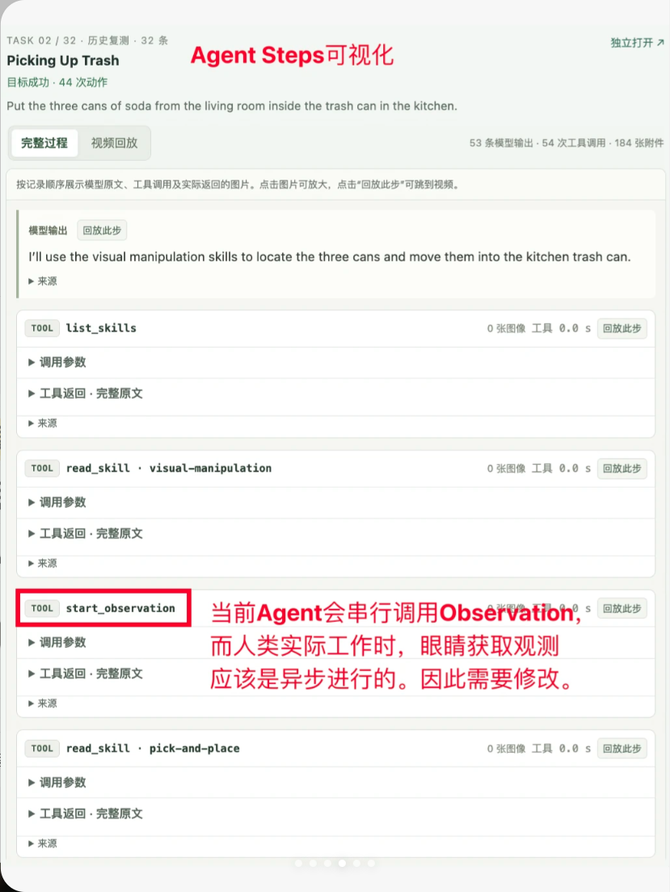

# FastHarness 第一次会议纪要

- 日期：待填
- 参会：待填
- 记录：待填

## 当前主线（阶段 1）

1. 调研 GPT + VLM 的结合方式：怎么外挂 VLM；Qwen 等 VLM 尽量做选择题
2. 调研 Code + VLA 怎么结合：策略如何组织（定位到源码分析）；有没有 WAM

**要求**：需要兼容多个 LLM 和下游 policy

3. 浩然可能考虑阶段 2：专注 memory 怎么做，从 LLM 的角度迁移

## 待办

| 事项 | 负责人 | 状态 |
|---|---|---|
| GPT + VLM 结合方式调研 | 待填 | 进行中 |
| Code + VLA 结合方式调研（读源码，查 WAM） | 待填 | 进行中 |
| Memory 方案（阶段 2） | 浩然 | 待开始 |

## 本次新增论文

见 [CHANGELOG](../CHANGELOG.md)。

## 原始文档与讨论补充

- [FastHarness 原始文档与论文表](sources/2026-10-12-FastHarness/FastHarness.md)（2026-10-12 导入，会议日期仍待填）
- [团队思考与 Harness 测评方向](../ideas/2026-10-12-FastHarness讨论与测评.md)

### 文档原始配图

