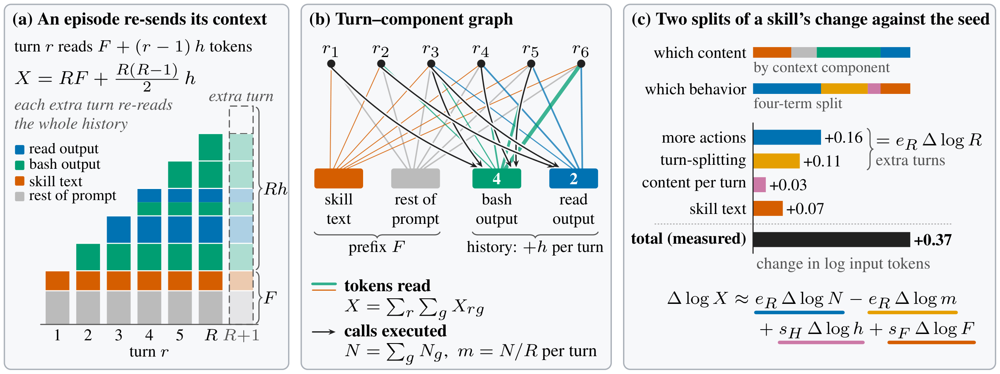

# BiPA：Skill 更新的收益与成本诊断

| 字段 | 内容 |
|---|---|
| 完整标题 | Does Your Generalist Skill Optimizer Really Incentivize Agentic Tasks? Rethinking Skill Optimization via Bipartite Attribution |
| 模块 | 6. Harness 进化 |
| Year / Venue | arXiv 2026.10；2610.37201v1，2026-10-27 |
| Team | 上海人工智能实验室、复旦大学、上海交通大学、中国科学技术大学、清华大学 |
| 作者 | Jiawei Zhou、Bo Peng、Yuxuan Huang、Ming Zhang、Youbang Sun、Xiang Wang、Chaochao Lu；Youbang Sun 与 Chaochao Lu 为通讯作者 |
| Paper | https://arxiv.org/abs/2610.37201 |
| Code | https://github.com/valleysprings/BiPA |

Codex 依据用户理解及原论文正文、附录整理。归入 Harness 进化中的“收益与成本诊断”；未找到独立项目主页，未发现论文已录用的官方声明。

## 问题

Harness 持续 Rollout 并迭代 Skill 时，小开发集上的成绩提高可能来自随机波动与候选选择偏差；新增规则还可能增加执行轮次和上下文重复读取，而成功率本身无法反映这些成本。

本文的 Skill 指放入模型上下文的自然语言操作流程，不是机器人底层控制策略；一个 turn 是一次模型请求，一个 turn 可以发出多次工具调用。

## 一句话：解决方案

通过候选选择回放检验收益可信度，以“执行轮次—上下文”二部图追踪 Token 成本，再据此提出 Skill 编辑与验收原则。

## 方法：分析框架

BiPA 读取优化器已经产生的轨迹与编辑记录，分析 Skill 更新改变了什么；不改变被研究优化器的运行过程。

| 分析环节 | 输入与操作 | 回答的问题 |
|---|---|---|
| 候选选择回放（Selection Replay） | 用种子技能重复运行的统计信息建立随机任务模型；令候选与种子相同，模拟原优化器的候选数量、起始分数及接受规则 | 即使没有有效修改，单靠反复挑选高分候选，也会报告多大的开发集增益？ |
| 轮次—上下文二部图 | 一侧为每次模型请求，另一侧为 Skill 文本、其余提示词、Agent/用户消息及工具输出；边记录读取的 Token 与工具调用 | 哪些内容在什么轮次被读取、反复读取了多少？ |
| 四项成本分解 | 将输入 Token 的变化分为工具调用增多、相同调用被拆到更多轮次、每轮新增内容变多、Skill 前缀变长 | 成本主要来自规则文本，还是规则诱发的执行行为？ |
| 规则与行为对照 | 对新增规则分类，结合日志检查重复验证、单次调用后等待下一轮的行为 | 编辑器增加的规则，与额外轮次怎样对应？ |

**为什么多一轮会更贵：**本文使用的 OpenCode 不压缩历史，每轮重新发送前缀和完整对话。新增一轮既重新读取已有历史，也会让后续轮次继续读取新产生的内容。

**分析范围：**Token 总量取自提供商报告，包含缓存 Token；上下文分量按内容长度分摊。四项分解是一阶近似的成本核算，不是对每条规则的成功率做因果归因。选择回放也依赖任务随机模型的假设，不能将它直接当作部署时的通用验收器。

来源：论文 §3–4、图2、附录 C.1/C.3、D。

## 四项优化原则

| 原则（§6） | 实际含义 |
|---|---|
| 收益超过选择本身产生的增益，才接受更新 | 保留父版本，直到候选的收益超过“无有效修改也会被选出来”的范围；成功率难以区分时，成本差异也要超过运行噪声 |
| 按新增执行轮次核算成本 | 不能只惩罚 Skill 文本长度；重点检查规则是否增加模型请求、重复验证或将调用拆开 |
| 允许删除与合并规则 | 编辑不只追加规则；也应消除重复规则，并减少可独立并行的读取与无用工具返回 |
| 将历史规则的成本反馈给编辑器 | 将先前修改增加的轮次和输入 Token 提供给下一次编辑，使成本在生成修改时就被考虑 |

这些是由分析得出的设计原则。论文还做了接受规则模拟及成本重新核算，但没有将四项原则全部实现为一套新的端到端优化器，并证明其整体性能。

## 实验结果

### 测试设置与统计口径

| 项目 | 设置 |
|---|---|
| 优化器 | GEPA、SkillOpt、SkillAdam |
| 执行模型 | DeepSeek-V4.1-Flash、GPT-6-Luna；high reasoning effort |
| Harness | OpenCode v1.14.31，保留完整历史 |
| 初始技能 | 相同的人工编写种子 verification-before-completion |
| 训练与开发 | 每基准共享160条训练 episode供编辑器抽批次；开发集通常30任务，TB2为9任务；SkillAdam使用小批次验收，Luna下另有训练批次验收设置 |
| 测试集 | Terminal-Bench 2.1：18任务（Luna排除一个测试脚本超时任务，实际17）；τ³-bench：75任务；AutomationBench：120任务；与训练/开发任务隔离 |
| 重复测试 | 每个技能测试3次，成功率为avg@3，不是三次中成功一次就算成功 |
| 技能数量 | 原有18个“优化器×模型×基准”配置；Luna/TB2的GEPA与SkillOpt返回原始种子，剩16个学习技能 |

输入 Token 比率先在每个任务上比较技能与种子的三次平均 Token，再跨任务取几何平均；不是“全部 Token 相加后直接相除”，也不等于 API 费用或墙钟耗时。

### 原表1节选：成功率与输入 Token

每个单元格为 **成功率% / 输入 Token 比率**；Seed 的输入比率为1。下表节选原表的这两项指标，完整原表还列执行轮次与工具调用比率。

| 模型 | 配置 | Terminal-Bench 2.1 | τ³-bench | AutomationBench |
|---|---|---:|---:|---:|
| DeepSeek | No skill | 72.2 / 0.94 | 73.8 / 0.98 | 36.4 / 0.88 |
| DeepSeek | Seed | 75.9 / 1.00 | 76.4 / 1.00 | 45.0 / 1.00 |
| DeepSeek | GEPA | 74.1 / 1.34 | 75.6 / 1.15 | 44.2 / 1.21 |
| DeepSeek | SkillOpt | 64.8 / 1.43 | 79.1 / 1.22 | 41.7 / 1.25 |
| DeepSeek | SkillAdam | 68.5 / 1.37 | 75.1 / 1.09 | 44.7 / 1.08 |
| GPT-6-Luna | No skill | 70.6 / 0.96 | 64.9 / 0.98 | 27.5 / 0.82 |
| GPT-6-Luna | Seed | 68.6 / 1.00 | 69.3 / 1.00 | 37.2 / 1.00 |
| GPT-6-Luna | GEPA | 68.6 / 1.00 | 65.3 / 1.04 | 41.4 / 1.07 |
| GPT-6-Luna | SkillOpt | 68.6 / 1.00 | 63.1 / 1.01 | 42.8 / 1.25 |
| GPT-6-Luna | SkillAdam | 74.5 / 1.20 | 64.9 / 1.05 | 43.6 / 1.32 |

### 结果说明了什么

- **总体收益很小，成本上升。**对16个学习技能的测试任务汇总，成功率相对种子为 **+0.1个百分点**，输入 Token 比率 **1.16**。这是被分析技能的观测结果，不是 BiPA 提升成功率或降低成本的实验。
- **开发集增益不一定是真实改进。**DeepSeek 下，SkillOpt/GEPA 的不变候选选择回放，以 **0.56–0.94** 的概率达到原报告的开发集增益。这个概率是零效应回放超过观测增益的比例，不是“技能无效的概率”。
- **运行行为比文本长度更能解释成本。**在59个可识别父版本的 DeepSeek 编辑中，轮次变化单独解释输入 Token 变化方差的 **93%**，Skill 长度变化解释 **10%**；两项是各自的解释率，不能相加。
- **规则倾向累积。**两模型共97个有评分且可识别父版本的编辑中，91个使技能变长；新增规则中约一半要求验证，没有规则要求少读内容。
- **不是所有配置都无收益。**Luna/AutomationBench 的学习技能高于种子；更换弱的三词种子后也能产生更大收益。结论受初始技能、模型、任务与验收协议限制。

来源：§5、表1、附录 A、C.1/C.3/C.5、E。四项分解与历史压缩的反事实核算不等于重新执行一套压缩历史策略；论文也未报告机器人真机或具身仿真实验。

## 用户理解与分类定位

按用户提供的理解整理：**关注 Skill 更新是否有效、性能提升是否可信、规则增加了什么执行成本**，归入 Harness 进化的收益与成本诊断方向。

**不能写成 Skill 适用边界识别机制。**论文研究跨模型与跨基准迁移，但没有建立一套在当前状态判断某项 Skill 适用或不适用的机制。

**也不能写成强制约束系统。**BiPA 是事后测量、分析与诊断框架，四项原则可为候选验收和编辑器设计提供依据；它没有直接替 Harness 强制执行这些原则。

论文还明确指出：输入成本可按轮次分解，但最终成功奖励不能由这一成本图直接分配给每条规则；逐规则的收益归因仍是未解决的问题。其测量结果也不能据以断言所有 Harness 进化都无效。

## 来源与公开材料

- [原论文v1](https://arxiv.org/abs/2610.37201v1)：§3定义与指标，§4方法，§5/表1实验，§6四项原则，Limitations，附录 A/C/D/E。
- [官方代码](https://github.com/valleysprings/BiPA)：提供分析与实验脚本。README说明原始运行记录未发布，依赖的harness-bench也未随仓库公开；本次未运行复现实验。
