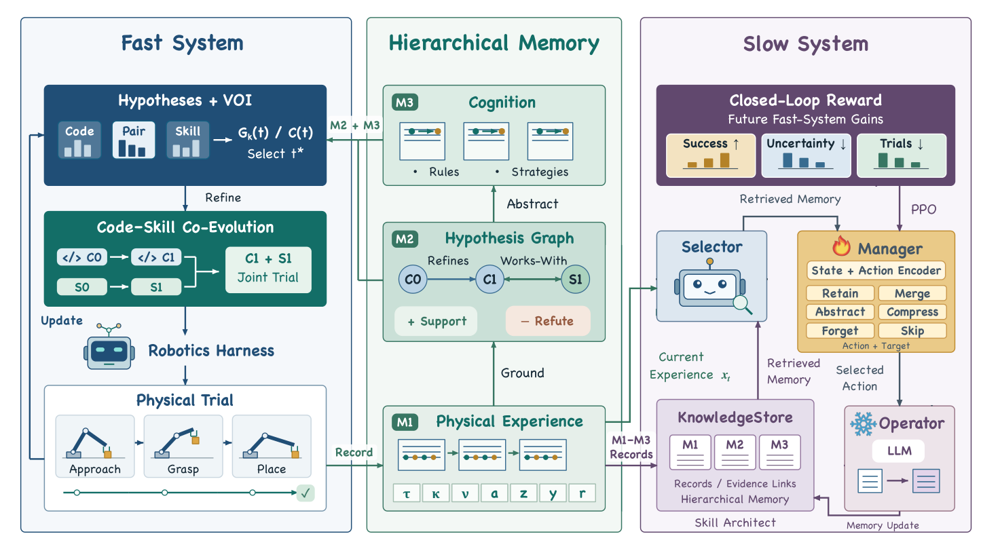
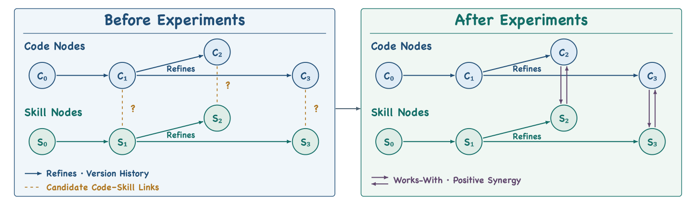

# EmbodiedRSI: Active Continual Robot Learning Through Hypothesis-Guided Co-Evolution

| 项目 | 内容 |
|---|---|
| 模块 | 3. Memory |
| 关联方向 | Harness 进化、RSI 与自我改进 |
| Year / Venue | arXiv 2026.10（v1：2026-10-07） |
| Paper | https://arxiv.org/abs/2610.10498v1 |
| Website | https://geeksongs.github.io/agentic_robotics/ |
| Code | 未找到已确认的机器人执行与 PPO 训练实现；作者公开仓库目前提供项目网站 |
| Team | Columbia University、Princeton University |
| 整理 | Codex 根据原论文与用户讨论整理；2026-10-30；非原摘要译文 |

## 一句话

冻结 VLA，用物理试验演化代码与技能，并以后续执行收益通过 PPO 训练记忆管理器。

## 问题

机器人失败后，既要决定修改代码还是技能，也要决定下一次做什么实验、保留和怎样整理经验。仅累积日志不能保证后续会用到有效经验，每次物理试验又有执行和复位成本。

## 方法

Fast System 维护代码与技能的候选假设，根据单位成本的预期信息增益选择实验，用匹配初始状态的试验比较修改效果。Slow System 将执行证据组织为三层记忆，Manager 选择记忆操作及目标，冻结的 Operator 执行操作。后续实验的成功率变化、假设不确定性变化与成本构成奖励，PPO 更新 Manager 的参数。依据：§3.1–3.3。



Fast/Slow 是代码技能迭代与经验组织的分工，不能直接等同于高速运动控制器和慢速语言规划器。

## 系统初始能力从哪里来

| 对象 | 论文明确说明 | 公开材料未说明充分 |
|---|---|---|
| 控制能力 | 使用冻结的机器人基础模型；真机为 SmolVLA | 仿真具体 checkpoint、控制接口与全部配置，正文指向附录 I |
| 真机初始化 | 每任务50条人工示范，SmolVLA全量微调20,000步、4张H200；随后试验中冻结 | 更完整训练设置，正文指向附录 B |
| 初始代码/技能 | 图2有 C0、S0，后续从已有版本修订 | 初始代码、技能清单及生成提示词 |
| 假设图 | 共享 Beta(alpha,beta) 先验，试验更新支持/反驳证据 | 先验数值、初始假设集合 |
| 初始记忆 | 定义 M1/M2/M3 并持续积累 | M0 是否为空、预置经验与冷启动过程 |
| 记忆 Manager | context、候选表示与评分函数可训练 | 初始权重、预训练过程及 PPO 详细配置 |

因此，不能说系统从完全空白开始自行获得全部机器人能力。基础模型先提供控制能力，外部 Harness 在此基础上改进。论文没有确认 Astra 参与指导；记忆 Operator 的 Qwen 型号也不能用来反推 Fast System 的 Planner。依据：§3.2–3.3、§4.1、§4.3。

## 按运行过程理解演化

以下是依据论文串联的概念流程，不代表已核验的代码调度或固定更新频率：

1. 检索已有 M2/M3，结合当前任务与经验提出代码/技能修改假设。
2. 对新假设做匹配试验，保持初始状态及其他调用条件一致，获得支持/反驳证据。
3. 按预期假设不确定性下降与成本的比值（VOI）选择后续实验。
4. 执行实验，将成功和失败都写入 M1，更新 M2 的证据和版本关系。
5. 比较代码修改、技能修改及联合修改，保留有效修订。
6. Manager 选择记忆操作及目标；Operator 整理索引或 M3，供后续检索。
7. 后续交互/评估产生反馈，形成记忆奖励与回报，用于 PPO 更新 Manager。

**并非每次执行完就必然进行一次 PPO 更新。**机器人 episode 索引与记忆决策索引不同；一次匹配比较可能需要多次 rollout。论文没有给出“执行多少次、产生多少条 PPO 样本、每多少条更新一次”的完整对应关系。

## 如何选择 code 和 skill 节点

选择的是能区分假设的实验，不是分别选置信度最高的代码和技能节点直接拼接。VOI 综合预期信息增益与试验成本，成本包含时间、仿真步数、GPU 与 reset。



| 图中信息 | 含义 |
|---|---|
| `refines` | 一个代码/技能假设到其修订版本的有向关系 |
| 支持与反驳计数 | 更新 Beta 后验；支持率置信度为 `(n_sup+alpha)/(n_sup+n_ref+alpha+beta)`，不是任务成功率 |
| `works-with` | 联合修改相比最佳单项修改有正成功率增益 |

联合增益为 `R(Ci,Sj) - max(R(Ci), R(Sj))`，来自匹配试验。仅改代码时保留原技能，仅改技能时保留原代码。依据：§3.2、图3。

## Memory 怎样记录、整理和使用

| 层次 | 保存什么 | 怎样参与后续执行 |
|---|---|---|
| M1 原始经验 | 每个 episode 的轨迹、工具、VLA调用时刻、动作、遥测、物理结果和任务奖励；包括失败 | 提供可追溯的原始证据 |
| M2 假设图 | 假设、置信度、修订版本、支持/反驳证据和联合关系 | 为实验选择及候选修订提供依据 |
| M3 归纳认知 | 从经验中提炼的规则与策略 | 检索后指导 Fast System 的下一次实验 |

需要区分三个选择：**选实验由 VOI 完成；检索相关记录的精确排序和数量未完整公开；加工这些记录的操作由 Manager 选择。**

Manager 用冻结的 Qwen3-Embedding-0.6B 编码当前经验、检索记录和候选操作描述，可训练函数聚合上下文、表示候选并打分，通过 softmax 选择“操作＋目标记录”。操作空间为 Retain、Merge、Abstract、Compress、Forget、Skip。

冻结的 Qwen3.5-122B-A10B Operator 按选择结果更新检索索引或 M3，保留原始 M1 及 M2 证据更新。不能将 Forget 直接理解为删除全部原始证据。动作细节被正文指向附录 C，可得材料中缺少该附录。

## 参数更新发生在哪里

| 对象 | 更新方式 |
|---|---|
| 代码与技能 | 生成候选、匹配试验、保留有效版本；图中记录修订关系 |
| 记忆内容 | 写入经验、更新假设计数和关系、加工索引与归纳规则 |
| Manager | PPO 更新 `f_ctx`、`f_skill`、`f_score` |
| 基础 VLA、Operator、Embedding | 方法进化阶段冻结 |

`f_skill` 在这里表示候选**记忆操作**的表示函数，不是机械臂技能网络。原始经验也不是直接拿去更新 VLA 权重，而是经检索和整理参与决策，再以执行反馈训练 Manager。

论文的 `refines` 说明逻辑版本关系，但没有公开代码与技能是否使用 Git、怎样保存快照、原子切换或回滚的完整实现。不能把假设图直接说成 Git 版本管理。依据：§3.2–3.3。

## 反馈数据怎么获得

反馈来自后续机器人实验的执行结果，再由系统计算成奖励；不是让 LLM 直接给这次记忆操作打分。

具体有三类数据：

| 反馈 | 从哪里获得 | 怎么计算 |
|---|---|---|
| 任务成功率变化 | 多次任务执行的成功/失败结果 | 修改记忆后的成功率 − 修改前的成功率 |
| 假设不确定性变化 | 对照实验对各假设的支持/反驳证据 | 更新假设概率，比较更新前后的不确定性 |
| 实验成本 | 运行日志与计时统计 | 耗时、仿真步数、GPU成本、重置成本 |

对应到一次记忆决策，过程是：

```text
已有当前成功率估计 Rₜ、假设不确定性 Hₜ
                      ↓
Manager 选择：合并某几条记录
                      ↓
Operator 修改记忆
                      ↓
系统利用新记忆安排并执行后续实验
                      ↓
收集任务成败、假设证据、运行成本
                      ↓
得到 Rₜ₊₁、Hₜ₊₁、成本 Cₜ₊₁
                      ↓
计算奖励，关联回此前的记忆决策
```

论文 §3.3 的奖励为：

```text
r = λ₁ × (Rₜ₊₁ − Rₜ)
  + λ₂ × (Hₜ − Hₜ₊₁)
  − λ₃ × Cₜ₊₁
```

因此，记忆操作执行完时，训练样本还没完整；要等后续实验反馈回来，才能补上奖励。论文要求前后成功率使用同一评估协议，不确定性在同一假设集合上比较。

这里最关键的缺口在 R，也就是成功率估计：

- 单次执行只提供一次成功或失败，不能可靠代表成功率。
- 成功率需要汇总多次执行。
- 论文没有说清每次汇总多少次、复用已有结果还是额外跑评估、使用哪些任务和种子。

而且，后续实验中代码和技能也可能变化。因此，这个奖励衡量的是记忆决策之后系统整体表现的变化，不等于已经严格隔离出了这次记忆合并的独立贡献。

“旧策略选择该操作的概率”直接来自 Manager 当时输出的动作概率，由训练程序记录，不需要机器人额外反馈。这是标准 PPO 所需的信息；该论文没有公开具体采集代码。

**要等反馈才能补上奖励，不代表下一步决策必须等待一次 PPO 更新。**下一步可以继续使用当前策略；论文没有讲清具体收集多少数据、多久更新一次。

“测试经验”应更准确地称为**进化期交互/评估反馈**。论文报告进化与评测种子分离，不能据此说最终测试集用于 PPO，也不能据此确认奖励估计与最终测试完全隔离。

## 实验结果

以下为原论文报告值，Codex 核对并整理；不是独立复现或当前官方排行榜排名。

| RoboCasa365（表1，%） | Atomic-Seen | Composite-Seen | Composite-Unseen | Overall |
|---|---:|---:|---:|---:|
| Harness VLA | 91.3 | 55.8 | 40.1 | 63.6 |
| EmbodiedRSI | 94.4 | 63.1 | 71.3 | 77.0 |

其他结果：LIBERO-Pro overall 为86.8%；SO-101真机5任务，每条件每任务30次，SmolVLA为46.0%，加Harness后71.3%（§4.2–4.3、表2–3）。真机“zero-shot”指仿真演化的Harness迁移，基础SmolVLA此前已有每任务50条示范微调，不能称整个系统未经真机数据训练。

### 怎样安排进化与评测

论文 §4.1：进化使用10个种子，评测使用另外10个不重叠种子；每任务每评测种子10次，即每任务100次。

RoboCasa官方多任务协议是50任务，18个Atomic-Seen、16个Composite-Seen、16个Composite-Unseen，在预训练厨房评测。**Unseen相对于基础模型预训练任务，不自动等于Harness进化未见任务。**若论文完整使用标准50任务，则最终评测为5,000次，这是按协议推算，并非从公开运行日志核实的总量。

种子分离不等于任务留出。公开材料还没有说明充分：进化任务池与评测任务池关系、是否逐任务独立进化、是否共享记忆、评测时Manager与记忆是否冻结/清空、奖励估计是否另外采样。图表中“50 episodes后”的效果是学习曲线检查点，不能当成每50次做一次PPO更新。

### Memory 消融能验证什么

| 表5：Composite-Unseen | 成功率 | Learning AUC |
|---|---:|---:|
| Retrieval-based Selection | 61.7% | 0.556 |
| PPO + Task Reward Only | 65.2% | 0.589 |
| 完整方法 | 71.3% | 0.635 |

消融比较了完整记忆模块与奖励设计的效果，没有给出完整的PPO参数迭代轨迹。

## 来源与材料边界

- [原论文v1](https://arxiv.org/html/2610.10498v1)：§3.2假设图、VOI与代码技能演化；§3.3记忆与PPO奖励；§4.1评测；§4.3初始化与真机；表1–3/5。
- [作者项目页](https://geeksongs.github.io/agentic_robotics/)：框架与指标；摘要局部仍使用EmbodiedEvo名称，以论文正式题名为准。
- [作者公开仓库](https://github.com/Geeksongs/agentic_robotics)：核对时默认可见分支为website，提供项目网站，不作为已公开PPO实现的证据（2026-10-30）。
- [RoboCasa官方多任务协议](https://robocasa.ai/leaderboard.html)：50任务与18/16/16分组口径。
- [PPO原论文](https://arxiv.org/abs/1707.06347)：用于说明一般PPO流程，不替代EmbodiedRSI实现证据。

本地已核对PDF共12页及LaTeX源码。公开下载包中的`supplement-references.tex`仅有附录A–I标签映射，未包含被正文引用的完整附录内容，因此无法据其确认PPO配置、记忆动作细节和仿真backbone设置。
