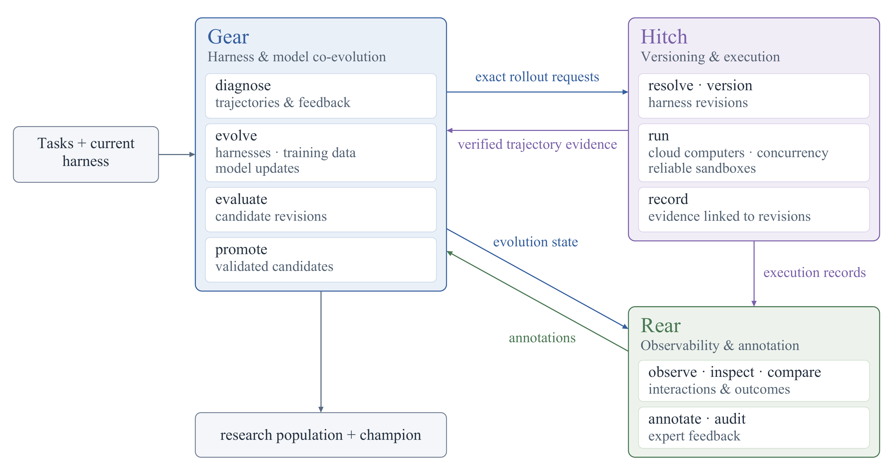

# GEAR：Harness 进化搜索

| 字段 | 内容 |
|---|---|
| 完整标题 | GEAR: An Open General Evolutionary Architecture for Recursive Self-Improvement of LLM Agent Harness |
| 模块 | 7. RSI Projects |
| Year / Venue | 项目预印本 2026.10；官网尚未提供 arXiv 全文入口 |
| Team | Imperial College London、Duke University、香港中文大学、Brown University；另有独立研究者 |
| 作者 | Yehui Tang、Guanqi Zhu、Shao-Jun Xia（共同一作）；Xin Chen、Mengzhe Geng、Hongyang Du、Yuhao Tang；Yehui Tang 为通讯作者 |
| Website | https://rsi-gear.github.io/ |
| Code | https://github.com/rsi-gear/gear |

Codex 根据提供的笔记、作者官网及官方文档整理。阅读范围为公开项目资料，不作为已读论文全文的解读；代码文档固定于 `8fc5205`（2026-10-26）。

## 问题

任务执行时的纠错往往只影响当前尝试；如何从跨任务轨迹中识别重复失败，将有效修改保留为后续可复用的 Harness，并用一致的评测证据筛选版本？

## 一句话：解决方案

Task-Agent 执行并产生反馈，Meta-Agent 据此提出 Harness 修改，再通过进化搜索、分阶段评测与版本晋升保留改进。

## 方法：系统框架

| 环节 | 输入 | 操作与输出 |
|---|---|---|
| 任务内循环 | 任务、当前 Harness、工具反馈 | Task-Agent 调整推理、规划与行动，产生轨迹和结果 |
| 跨任务改进 | 任务轨迹、评分、重复失败与有效策略 | Meta-Agent 诊断共性问题，提出可复用的修改方案 |
| 搜索与评测 | 父版本、修改方案、任务集、预算 | 生成候选，选择评测任务，比较证据并保留版本 |
| 后续执行 | 晋升后的 Harness | 用新版本执行后续任务，再收集反馈 |

**可改内容：**提示词与执行策略、工具与接口、技能与工作流、上下文管理。公开主结果比较的是 Harness 优化效果，没有据此证明模型参数训练的收益。

**系统分工：**GEAR 组织优化；Hitch 负责指定版本的执行、隔离环境与证据记录；Rear 用于观察、比较和标注。官网架构图还包含模型训练方向，属于更广的研究设计，不能将图中全部功能当作当前实验已经验证的能力。

来源：[官网 Framework / Research stack](https://rsi-gear.github.io/)。

## 分阶段评测与晋升

**基本流程：**诊断 → 生成候选 → Local → Bridge → Full seed → 晋升判断。

| 阶段 | 具体含义 |
|---|---|
| Local | 在局部任务范围评测候选，筛选进入下一阶段的版本 |
| Bridge | 扩大任务范围，检查候选在更广任务上的表现 |
| Full seed | 在完整种子任务集上评测；“完整”不自动代表独立测试集 |
| Promote | 由运行时执行最终验收；中间阶段排名靠前不代表一定晋升 |

当前 Python 文档给出的默认候选宽度是 **4 → 2 → 1**：允许生成 4 个候选，最多 2 个进入 Bridge，最多 1 个进入完整种子集评测。任务采样比例是另一组设置：任务池充分时，Local 合并 8% 局部、4% 共享、3% 交叉任务，Bridge 为 40%，最后为 100%；不足时实际局部并集可能更小。

100 个种子任务的文档示例中，复用已有评测单元后，新候选执行量为 **170 次**：4×15＋2×(40−15)＋(100−40)。这只统计候选执行，不含基线、父版本补测、独立留出测试与无效执行修复，也不是实测总成本。

**历史实验与当前实现要分开：**Marketing 历史实验也采用 4 → 2 → 1，但按失败类型组织局部范围和 Bridge 名额；当前 Python 实现采用父版本批次共享局部范围。官方文档明确说明：宽度相同不能复现完整历史算法，历史结果不是当前 Python 实现的测量。

来源：[固定版本的算法示例](https://github.com/rsi-gear/gear/blob/8fc520549a7a26af1122fac27ca6d9e20b75ab20/docs/guide/en/example-algorithm.md)。

### 原笔记中“五个可替换组件”的范围

官网列出父版本选择、修改方案规划、任务采样、评分规则、候选排序五个设计边界，并注明当时的 staged 实现公开父版本选择钩子。当前仓库文档则将 Python API 组织成父版本、采样、提案、排序、停止、阶段组合六类契约。两者属于不同抽象和实现说明，不宜直接写成“五个组件都已开放任意替换”。预算、执行、证据身份、留出验收与最终冠军更新仍由运行时负责。

## 实验结果

下表抄录官网公开结果的四个配置，单位为 %。AutomationBench 同时报告任务通过率与目标完成度；Terminal-Bench 2.1 报告任务通过率。

| 模型与推理档位 | Harness | Marketing 通过率 | Marketing 完成度 | Support 通过率 | Support 完成度 | Terminal-Bench 2.1 通过率 |
|---|---|---:|---:|---:|---:|---:|
| GPT 5.6 Luna · medium | DSH Base | 27.0 | 75.4 | 17.0 | 72.9 | 52.8 |
| GPT 5.6 Luna · medium | DSH + GEAR | 40.0 | 83.9 | 25.0 | 81.3 | 62.9 |
| GPT 6 Astra · max | Codex | 57.0 | 84.1 | 35.0 | 88.4 | 86.7 |
| GPT 6 Astra · max | DSH + GEAR | 61.0 | 86.3 | 39.0 | 88.7 | 87.6 |

Luna 同模型、同推理档位下，三项任务通过率分别提高 **13.0、8.0、10.1 个百分点**。Astra 对照同时由 Codex 换成 DSH，因此其结果是整套 Harness 配置的差异，不能单独归因于搜索算法。

### 这些结果能说明什么

- **支持 Harness 改进有收益：**固定 Luna 与 medium 档位，优化后的 DSH 在三类任务上得分提高。
- **不等于已证明未见任务泛化：**Marketing 的 100 个公开任务采用 `shared-set-research`，官方数据明确记录 `independentHeldOut: false`。Support 和 Coding 的该结果汇总未给出独立留出声明，不能自行补上。
- **不等于纯 Staged GEPA 消融：**官网汇总覆盖早期优化与 staged 延续的完整演化链，不能把全部增益归因于单个阶段或组件。
- **不等于完全无人参与：**Marketing 公开记录包含无效结果补全及最终晋升的操作员授权。自主程度应按具体运行协议描述。

来源：[官网结果数据](https://rsi-gear.github.io/assets/paper-results.json)、[Marketing 任务与验证模式](https://rsi-gear.github.io/assets/marketing-results.json)。公开资料未报告机器人仿真或真机实验。

## 阅读收获与相关问题

以下为 Codex 结合所提供笔记整理的理解，区别于作者实验结论。

1. **可复用对象是执行规则与版本。**一次任务内重试解决当前失败；跨任务改进需要将修改绑定到明确版本，再比较该版本在一批任务上的收益与退步。
2. **分阶段筛选可以控制候选评测开销。**但最终必须检查更广的任务范围；局部任务得分升高，不足以证明跨任务有效。
3. **用于我们的 Harness：**可以先固定原语、VLA 与模型，把规划、失败重规划、工具返回检查和历史保留规则作为候选修改对象；记录父版本、修改内容、任务、seed、结果和耗时。
4. **需要额外回答：**收益能否迁移到未参与修改的任务？需要固定开发集与独立测试集，同时报告成功率、退步任务、调用量及总成本。GEAR 当前 Marketing 结果不能代替这个对照。

## 来源

- [作者官网：框架、作者、结果与预印本状态](https://rsi-gear.github.io/)。
- [官方代码与 README](https://github.com/rsi-gear/gear/tree/8fc520549a7a26af1122fac27ca6d9e20b75ab20)。本次使用其公开说明，没有运行复现实验。
- [算法示例：候选宽度、任务比例、成本示例、历史实现差异](https://github.com/rsi-gear/gear/blob/8fc520549a7a26af1122fac27ca6d9e20b75ab20/docs/guide/en/example-algorithm.md)。
- [结果数据](https://rsi-gear.github.io/assets/paper-results.json)与 [Marketing 记录](https://rsi-gear.github.io/assets/marketing-results.json)，读取于 2026-10-28。
