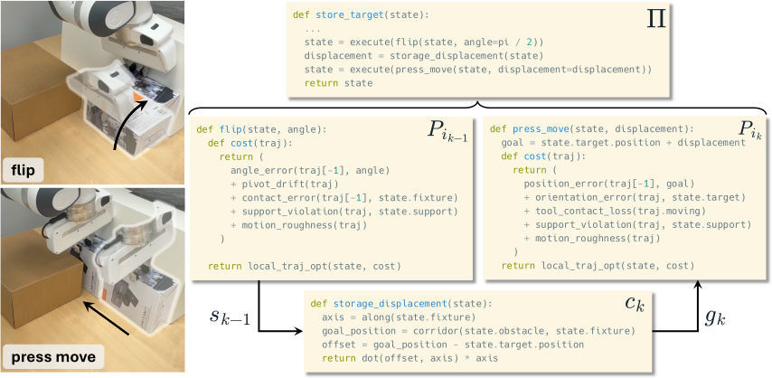

# RAPID: Robot Agentic Programming from Demonstrations

| 字段 | 内容 |
|---|---|
| 模块 | 10. Sim2Real |
| Year / Venue | arXiv 2026.09；v1，2026-09-24 |
| Team | MIT、NUS、University of Pennsylvania、NVIDIA |
| Paper | https://arxiv.org/abs/2609.30249v1 |
| Code | https://github.com/nature21/RAPID |
| Website | https://yuyaoliu.me/projects/rapid/ |

[返回分类](../README.md#sim2real) · [完整阅读HTML](../reports/rapid.html)

## 一句话

从人类演示重建仿真，构建并验证原语及连接约束；在新场景中重新计算阶段目标、优化轨迹，再迁移真机。

## 问题

机器人程序开发依赖人工设计的操作原语、成功判据和可验证环境；固定坐标与轨迹难以适应物体和场景变化。

## 方法

**演示＋任务描述 → 分段与RGB-D场景重建 → 原语构建和仿真验证 → 关系约束组合 → 新场景实例化 → 真机执行。**

Coding Agent负责提出目标、成功判据、几何计算和代码，在仿真执行反馈后修订。每个原语包含语义目标、关系接口、几何解析器、优化代价和成功判据；CEM在仿真中搜索动作轨迹，不更新基础模型参数。

### 阶段间关系的表达

每个阶段包含调用的原语、角色映射和连接约束。代码中，角色绑定采用结构化数据，连接函数计算具体参数；描述文件记录目标、假设和约束含义。

| 表达 | 作用 | 例子 |
|---|---|---|
| 有序原语调用 | 规定执行顺序 | push → flip → grasp |
| 角色映射 mₖ | 将策略物体绑定到本阶段角色 | 翻转和抓取操作同一个盒子 |
| 连接约束 cₖ | 在阶段开始时，依据场景与前一阶段末状态计算效果参数 | 翻转后计算按压移动的位移 |
| 状态传递 | 前一阶段的结果成为下一阶段的起点 | 用翻转后的物体位置和姿态继续求解 |

以上按作用展开，不是论文另设的四类约束。原语接口另有关系要求Γᵢ，例如物体受到支撑、夹具具有朝向物体的竖直面且机械手可达。

图3先执行flip。连接函数根据棕色障碍物与白色夹具确定目标位置，减去翻转后的物体位置，再沿夹具轴投影，得到press_move需要的位移。它传递的是**由当前状态计算的效果参数**，而非预先写死的移动距离。

公开代码还使用`TransitSpec`描述阶段间释放、撤离和接近，并继承仿真及控制器状态。原语判据为假不会自动终止整条策略；执行或接口错误才阻止后续阶段，最终由策略判据Ψ判断任务成功。来源：§IV-B、图3；官方`workspace/src/strategies/explanation.md`。

### Sim2Real与开发耗时

- **开发：**每任务一条演示，在重建场景及可行变体中执行验证、修改原语与组合；程序构建为数十分钟量级。
- **新场景：**RGB-D重建后，将物体绑定到程序角色；语义绑定为数秒，不包含全部重建与运动优化。
- **部署：**策略及原语代码固定，根据新几何计算目标并优化轨迹，由Franka Research 3和柔顺操作空间控制器执行；未报告端到端总耗时。

来源：§III–V、§VI-B/D。上述开发设置对应八任务主实验；LIBERO-Pro另用无演示初始化。

## 仿真结果

MuJoCo／FR3八个接触操作任务，每任务50个新场景，重复3次。八任务平均成功率：

| 方法 | 均值±标准差 |
|---|---:|
| CaP-Agent0 | 14.6% ± 2.5% |
| RAPID，不生成场景变体 | 53.2% ± 7.1% |
| RAPID完整方法 | 75.9% ± 2.4% |

CaP-Agent0额外获得真值成功反馈，并可在测试场景中执行与修订程序；不能描述成等开发预算对照。来源：§VI-A/B、表II。

LIBERO-Pro不提供演示，只给任务描述和一个调试场景；RAPID的Object／Goal／Spatial位置扰动成功率分别为100%／67%／83%，指令扰动为95%／53%／81%。论文未完整报告该组开发与测试种子、尝试预算和代码修订权限，不能直接套用八任务主实验协议。来源：§VI-C、表III。

## 真机结果

FR3机械臂、平行夹爪、RealSense L515。八任务各10个测试场景，T1–T8成功率依次为90%、80%、70%、60%、70%、40%、70%、60%，来自图5的标注比例。来源：§VI-D、图4/5。

## 代码与复用边界

- 核对版本`07a7a1e`公开工作流SKILL模板和共享基础设施，干净工作区未包含实验生成的六个具体原语包及运行日志。
- 论文实验用Codex＋GPT-5.6 Sol high；核对代码默认gpt-6-astra，应区分版本。
- 阅读分析：有限场景验证不保证约束在任意场景成立；任务间共享原语的设计，也没有独立量化跨任务技能积累的收益。

## 来源

- [论文v1](https://arxiv.org/abs/2609.30249v1)：§III–VI，表I–III、图2–5。
- [官方代码核对版本](https://github.com/nature21/RAPID/tree/07a7a1e2c65a61611713fc4d40b01d61bf38c42d)：原语构建、策略组合SKILL与阶段执行说明；2026-11-02核对，未运行实验。
- [项目页](https://yuyaoliu.me/projects/rapid/)。

Codex依据原论文与官方代码整理；分类按本次讨论确定。
