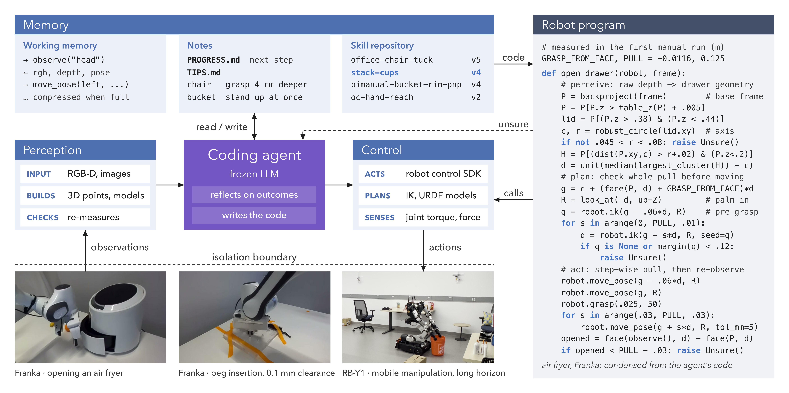

# RAX：Scaling Online Exploration for Robot Agents

| 字段 | 内容 |
|---|---|
| 完整标题 | Scaling Online Exploration for Robot Agents |
| 模块 | 7. RSI Projects |
| Year / Venue | arXiv 2026.10；v1，2026-10-15 |
| Team | Harvard、NVIDIA、UC Berkeley、MIT、Stanford |
| Paper | https://arxiv.org/abs/2610.22496v1 |
| Code | https://github.com/robot-agent-exploration/rax |
| Website | https://robot-agent-exploration.com/ |

Codex依据原论文与官方资料整理；分类按用户讨论确定。模型权重不更新。

[阅读版HTML](../reports/rax.html)

## 问题

机器人适配新任务与本体通常依赖额外演示数据和策略训练，已有策略受原训练分布限制。

## 一句话：解决方案

冻结的 Coding Agent 通过机器人接口自主探索，将有效的感知、规划和控制决策写成可复用 Python 程序，并保存经验与验证过的技能。

## 方法：系统流程

**任务与接口 → 观察和执行 → 分析反馈、修改代码 → 跨布局测试程序 → 保存技能与经验 → 后续任务调用和组合。**

| 对象 | 作用与改进方式 |
|---|---|
| Coding Agent | 根据观察、接口和反馈写代码、调用工具、调试程序；基座参数冻结 |
| 任务程序 | 包含感知、几何计算、规划、控制与检查；按新场景重新测量和计算，不能理解成固定轨迹回放 |
| Memory与技能库 | 保存当前工作上下文、任务笔记和跨任务可复用技能；随探索积累和更新 |
| 执行接口 | 提供传感器、SDK、IK及底层控制；论文不依赖任务特定手工动作原语，不等于没有工程接口或已有控制器 |

来源：§3.1–3.4、图2。此前讨论的“FastCode”对应探索后形成自主程序的机制，原论文v1未将其单独定义为同名算法。

## 实验结果与阅读边界

论文在仿真和真机上测试多本体、精细操作与长程任务，并观察增加探索预算后在未见场景上的表现提升。任务代码、记忆与技能是主要积累对象，没有进行本任务的SFT／GRPO参数更新。

RoboDojo的7个选定任务，在各任务最大探索预算下，平均**Score为78.3%**，VPP2为24.9%。这是包含部分完成得分的指标，不是完整RoboDojo基准或任务成功率；每任务评测30–50个未见布局，探索预算因任务而异。来源：§5.2.1、表1。

### 程序执行减少了什么开销

| 炸锅放香蕉任务（表9） | 动作生成计算／推理 | 机器人调用时间 | 输出Token |
|---|---:|---:|---:|
| Agent初次成功，包含探索 | 72.3分钟 | 2.9分钟 | 262.4k |
| 后续自主程序成功 | 18秒 | 2.5分钟 | 2.0k |

241倍对应动作生成开销之比，不能写成完整任务只需18秒；两行还包含从探索到已有程序的阶段差异。

### 评测模式要分开

- **纯程序评测：**冻结提交程序，在未见场景独立执行；主Agent不在线改程序。
- **Agent在环评测：**携带已有工作区，由Agent继续观察、运行代码和决策；不能与纯程序成绩混用。
- **跨任务复用：**真机案例组合先前会话获得的技能；这与在同一任务的新初始化上测试是不同的证据。

来源：§5.3.3、§5.5.1、附录§10.2；官方代码按机器人与仿真分支组织。

## 分类与和RPG的区别

归入**RSI 与自我改进 → Coding Agent驱动的机器人系统**：Coding Agent贯穿感知、规划、控制、探索、记忆与技能复用，程序既承担任务执行，也保存探索得到的能力。Code + Policy与技能成长保留为关联标签。

[RPG](rpg.md)同样冻结模型参数，但额外用离线数据构造仿真练习任务，比较普通执行与特权执行来诊断失败，再对共享技能和系统提示词做跨任务验收。RAX的本文主线不是自动重写Agent自身架构；论文将架构自改进列为后续方向。

## 来源

- [原论文v1](https://arxiv.org/abs/2610.22496v1)：原论文v1首页、§3、§5.1–5.5、表1/9、附录§10.2；既有官方real/rainbow与robodojo-behavior/native代码阅读记录。
- [官方项目页](https://robot-agent-exploration.com/)。
- [官方代码](https://github.com/robot-agent-exploration/rax)；本次未运行机器人程序。
