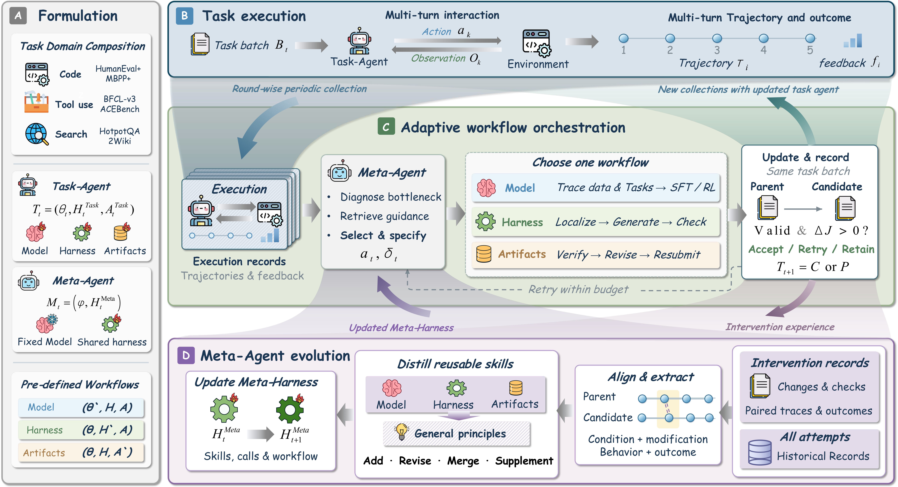

# RSIFlow：自适应改进与 Meta-Harness 演化

| 字段 | 内容 |
|---|---|
| 完整标题 | RSIFlow: Adaptive Self-Improvement Workflows with an Evolving Meta-Agent |
| 模块 | 6. Harness 进化 |
| Year / Venue | arXiv 2026.10；2610.21791v1，2026-10-15 |
| Team | 北京航空航天大学、清华大学、北京智源人工智能研究院（BAAI） |
| 作者 | Huan Zhang、Mingju Chen（共同一作）；Dongxu Zhou、Can Lv、Sen Cui、Faguo Wu、Shiji Zhou；首页列 Shiji Zhou 为联系作者 |
| Paper | https://arxiv.org/abs/2610.21791 |
| Code | https://github.com/1HUAN1/RSI-Flow |

Codex 根据提供的笔记、原论文正文与附录整理。未找到独立项目主页；官方仓库文档固定于 `496d3cf`。本文任务是代码生成、工具使用与多跳问答，没有机器人实验。

## 问题

Agent 的瓶颈会随着改进而变化：固定改模型或固定改 Harness 难以始终对症；组织改进的 Meta-Agent 也需要从此前的改进结果中积累经验。

## 一句话：解决方案

Task-Agent 执行任务，Meta-Agent 据反馈改进 Task 系统和自身 Harness，形成协同演化。

## 方法：系统框架

**核心：任务执行与改进机制相互反馈。**Task-Agent 用当前模型与 Task-Harness 执行任务；Meta-Agent 根据其轨迹和结果选择改进 Task 模型、Harness 或产物，同时将本轮改进经验用于更新自己的 Meta-Harness。下一轮由改进后的 Task-Agent 执行，并由更新后的 Meta-Harness 组织改进。

| 对象 | 包含什么 | 负责什么 |
|---|---|---|
| Task-Agent | Qwen3-4B / 8B 参数、Task-Harness、当前任务产物 | 规划与执行任务，输出代码、工具动作或答案，产生轨迹与反馈 |
| Meta-Agent | GPT-5.6 Sol、Meta-Harness | 诊断瓶颈、检索经验、选择改进路径、生成与验证候选、维护经验 |
| Task-Harness | Action、Skill、Planning | 组织任务执行的接口、经验与计划 |
| Meta-Harness | Action、Skill、Planning | 组织诊断、检索、改进路径选择与候选构建 |

**Meta-Agent 基座参数始终冻结。**它的演化发生在 Meta-Harness，而不是对 GPT-5.6 Sol 做 RL 或 SFT。官方发布的是 skill-based 变体：经验记忆会更新，Meta 可执行程序固定；没有发布可执行 Meta 程序演化变体。

来源：论文 §3.1–3.3、图2；[官方 README](https://github.com/1HUAN1/RSI-Flow/blob/496d3cfb9ff39997d107d0ff29e746b07e638180/README.md)。

### 三种改进路径

| 路径 | 改什么 | 怎么改 | 保持什么 |
|---|---|---|---|
| Model | Task 模型参数 | 默认对成功调用记录做 SFT / LoRA；附录另测 GRPO | Task-Harness 不变，不直接编辑任务产物 |
| Harness | Task 执行规则 | 定位 Action / Skill / Planning，修改提示词、上下文、检索、规划、工具编排或校验规则 | Task 模型参数不变 |
| Artifacts | 当前任务的代码或答案 | Meta 提供诊断，让 Task-Agent 根据允许的反馈修改、测试与重新提交 | Task 模型与 Task-Harness 不变 |

**经验复用和产物复用不同：**先前任务的答案不会直接成为新任务答案。可以跨任务复用的是修复条件与操作程序；新任务仍需生成自己的产物。

## 一轮如何执行与验收

| 步骤 | 实际操作 |
|---|---|
| 1. 固定父版本 | 固定本轮 Task 模型、Harness 和任务状态，在本轮训练批次运行，获得轨迹、反馈与基线成绩 |
| 2. 诊断与检索 | Meta 定位错误阶段，检索适用技能和反例，选择 Model / Harness / Artifacts 路径 |
| 3. 构造候选 | 先记录修改范围、预期行为和保留约束，再生成候选并检查实现有效性 |
| 4. 配对评测 | 候选与父版本在同一个训练批次上比较，计算候选成绩减去父版本成绩 |
| 5. 接受或重试 | 第一个“实现有效且成绩严格提高”的候选被接受；每轮最多尝试 2 次，均不合格则保留父版本 |
| 6. 维护 Meta 经验 | 成功、失败和无收益尝试都写入证据，形成或修订技能与原则；下一轮使用新的 Meta-Harness |

**两次候选都从本轮同一个父版本出发。**第二个候选不会叠加第一个失败候选的修改；一旦第一个合格，便不要求继续生成第二个。Task-Harness 也不是每轮必改，只有选中该路径且验收通过才保留修改。

来源：§3.2、Algorithm 1、附录 B.1–B.2。验收只要求训练批次的正增益，不保证未见任务成绩随轮次单调提高。

## Memory 怎么组织、怎么使用

**存的是“改进过程的经验”。**父版本与候选在相同任务上的轨迹按子目标、工具事件或错误特征对齐，同时保留完整任务结果。局部片段用于解释行为变化，不能替代整批评分。

| 经验字段（论文 §3.3） | 具体内容 |
|---|---|
| 适用条件 | 什么任务契约、错误和执行阶段下适用，哪些情况排除 |
| 修改范围 | Model、Harness 或 Artifacts |
| 条件化操作指导 | 诊断和修改的具体步骤 |
| 保留要求 | 修改时必须维持的行为或接口约束 |
| 预期行为响应 | 希望修改后出现什么变化 |
| 证据 | 支持与反驳该经验的案例、修改记录及前后轨迹和结果 |

经验分为 **Model / Harness / Artifacts 专用技能**与**跨路径的通用原则**。维护操作为 Add（新增）、Supplement（补证据）、Revise（修订并保留版本关联）、Merge（合并重复或被替代条目）。失败证据可以限制经验的适用范围，不能只保存成功案例。

**检索后再判断适用性。**附录 D.1 的案例检索器采用词项匹配：普通匹配词计 1，匹配的错误词总计 4；归一化领域别名，以记录 ID 破同分，返回上下文最多 24,000 字符、每个 bucket 最多一条，完整条目可按 ID 读取。这个分数用于检索证据，不是动作价值或预期收益的数值估计。

**检索结果进入下一次诊断和候选构建。**Meta 依据当前轨迹检查条目的条件与排除项，再决定改进路径和修改内容。论文描述还会调整调用这些知识的检索调用、阶段指令及补充提示；这与训练一个参数化路由分类器不同。公开仓库的 Meta 可执行程序固定。

来源：§3.3；附录 D.1–D.4、F 的技能卡。

## 开发与评测如何分开

| 用途 | 任务配置 | 反馈是否影响系统改进 |
|---|---|---|
| 进化开发 | 5 轮，每轮 600 个不同任务：代码、工具、多跳问答各 200；共 3,000 个不同任务 | 是，用于诊断、训练、候选验收和经验维护 |
| 独立报告 | 固定 744 个任务；完成指定轮数的进化后评测 | 否，报告成绩与逐项评测反馈不用于选择路径、接收候选、修改经验或人工挑选版本 |

| 领域 | 进化任务来源与总数 | 报告任务来源与数量 |
|---|---|---|
| 代码生成 | TACO / DeepCoder 子集 1,000 | HumanEval+ 164；MBPP+ 178 |
| 工具使用 | EnvScaler 1,000 | BFCL-v3 152；ACEBench 50 |
| 多跳问答 | HotpotQA 训练集 500；2Wiki 训练集 500 | 两者开发集各 100 |

报告时 **技能库与 Meta-Harness 跨任务固定**，不会边测边扩充。允许的环境反馈包含接口、长度与格式错误；不允许用参考答案或隐藏测试正确性来选择输出。训练中的“两次 Artifacts 候选＋按增益选择”不在报告集执行。

“3,000”是不同任务数，不是轨迹或调用总数；重试和成功记录回放会增加执行量。EnvScaler 的 176 个源 `heldout` 样本在本文被明确归为训练用途，不能因原目录名而算作报告任务。作者检查了任务 ID、规范化提示词哈希和任务组 ID 的重叠；这不排除语义改写或预训练污染。

来源：附录 A.1–A.3、表4–5。

## 实验结果

### 主结果：六个基准上的留出评测

表1节选 SIA 与 RSIFlow；保留原始小数。HumanEval+ / MBPP+ 为 pass@1，BFCL-v3 为原生准确率，ACEBench 为原生加权得分，QA 为答案 F1。Overall 是六项得分的等权平均，**不是 744 个任务的统一成功率**。

| Task 模型 | 方法 | HumanEval+ | MBPP+ | BFCL-v3 | ACEBench | HotpotQA | 2Wiki | Overall |
|---|---|---:|---:|---:|---:|---:|---:|---:|
| Qwen3-4B | SIA | 53.66 | 60.11 | 29.00 | 33.91 | 52.51 | 41.68 | 45.15 |
| Qwen3-4B | RSIFlow | 68.29 | 66.29 | 29.23 | 38.00 | 56.72 | 48.72 | 51.21 |
| Qwen3-8B | SIA | 73.78 | 70.22 | 40.13 | 51.46 | 53.96 | 46.43 | 56.00 |
| Qwen3-8B | RSIFlow | 76.34 | 74.10 | 41.36 | 52.62 | 62.67 | 52.08 | 59.86 |

与 Overall 最强基线 SIA 相比，4B 提高 **6.06 个百分点**，8B 提高 **3.86 个百分点**。RSIFlow 在 12 个“模型×基准”配置中领先 11 个；例外是 **8B 的 ACEBench，HarnessForge 59.07，高于 RSIFlow 52.62**，不能表述为全部配置最优。ACEBench 的 50 个任务产生 57 个原生评分记录，加权得分与完整任务成功率分母不同。

### 什么证据支持 Meta 经验有效

表2，Qwen3-4B、5轮。三个领域得分分别是各自两个基准的平均。

| 配置 | Code | Tool Use | SearchQA |
|---|---:|---:|---:|
| Vanilla | 48.25 | 29.70 | 34.52 |
| 自适应改 Task，关闭 Meta 演化 | 56.73 | 29.70 | 49.98 |
| Meta 演化，仅改 Harness | 63.42 | 32.93 | 44.89 |
| Meta 演化，仅改 Model | 50.31 | 32.15 | 44.73 |
| Meta 演化，仅改 Artifacts | 52.34 | 30.69 | 52.57 |
| 完整 RSIFlow | 67.29 | 33.62 | 52.72 |

关闭 Meta 演化后，三领域平均成绩由 51.21 降为 45.47，差 **5.74 个百分点**。这支持整套 Meta 经验维护与使用有收益，不能拆成“某个记忆字段单独贡献 5.74”。表3另将不同 Meta 版本用于同一个初始 Task-Agent：Meta0 与 Meta4 都选 Harness，Code 为 48.30→68.86，QA 为 44.62→54.13；说明只选对路径还不够，具体修改质量也有差异。

### 五轮案例：瓶颈变化后切换改进对象

| 轮次 | 路径 | 操作 | 案例报告的平均成绩 |
|---|---|---|---:|
| R1 | Harness | H1：检查是否提交符合契约的完整产物 | 32.23 |
| R2 | Harness | H2：依据工具返回凭证验证操作完成 | 38.04 |
| R3 | Model | 3,798 条合格调用记录，LoRA 微调 | 45.46 |
| R4 | Model | 5,397 条合格调用记录，复用并补充 M1 经验 | 47.11 |
| R5 | Artifacts | 修改、测试与重新提交当前代码；模型及 Harness 不变 | 51.21 |

这是附录 C.3 的顺序演化案例，不是每轮候选的全量成绩，也不是预先固定 H→H→M→M→A。3,798 / 5,397 是合格调用记录数，不能当作完整 episode 数。表3的“同一初始 Task、不同 Meta 版本”是另一组实验，不能与此串成同一条演化链。

### 成本与证据边界

作者的 rollout 预算比较不等于全部成本相同，还需计入 Meta 推理和训练。附录 C.5 中 GPT-5.6 Sol 在 HumanEval+ 的累计 Meta token 达 **252.6M**；第5轮新增 **160.8M tokens**，pass rate 由 60.13 提至 68.29。最后一轮有收益，但调用成本增长明显。主结果未提供可据以报告多次独立演化方差的结果，不能由单次序列保证稳定收益。

来源：表1–3、附录 C.3–C.5。上述结果均为 LLM 软件任务评测，没有真机或具身仿真成功率。

## 阅读收获：与 GEAR 及我们的 Harness 对照

以下为 Codex 结合所提供笔记整理的理解，区别于作者已完成的实验。

| 关注点 | GEAR | RSIFlow |
|---|---|---|
| 改什么 | 重点组织 Harness 候选搜索与版本评测 | 先选择 Model / Harness / Artifacts，再构造候选 |
| 经验如何起作用 | 跨任务执行证据支持修改与筛选 | 改进过程的前后证据形成技能和原则，参与下一轮诊断、路径选择与构造 |
| 评测能证明什么 | Marketing 共享100任务上的改进，不能据此证明未见任务泛化 | 训练与744报告任务隔离，支持开发得到的系统在留出任务上有效 |
| 尚不能推出什么 | 当前 Python 搜索接口一定复现历史全部收益 | 每条经验、每个字段的独立贡献，或直接迁移到机器人后的收益 |

**对我们的原语调用链，先积累“修复为什么有效”的证据。**除任务、观测和调用参数外，可以记录失败位置、原计划、重规划修改、父版本与候选、修复前后结果、保留约束、调用与耗时。由这些记录形成带条件和反例的改进规则，供 Planner 再次遇到相同错误时检索；这一步不要求立即训练模型。

**要验证跨任务收益：**开发任务用于形成经验，测试时冻结经验库，在未参与开发的任务上比较无经验、原始轨迹检索、结构化经验三组。这个对照是面向我们系统的建议，论文没有完成机器人上的此项验证。

## 来源

- [论文 v1](https://arxiv.org/abs/2610.21791v1)：§3、图2、表1–3；附录 A 数据与隔离、B 验收与训练、C 案例与成本、D 经验、F 技能卡。
- [官方仓库固定版本](https://github.com/1HUAN1/RSI-Flow/tree/496d3cfb9ff39997d107d0ff29e746b07e638180)：README 说明公开变体与材料范围。本次未运行复现实验。
